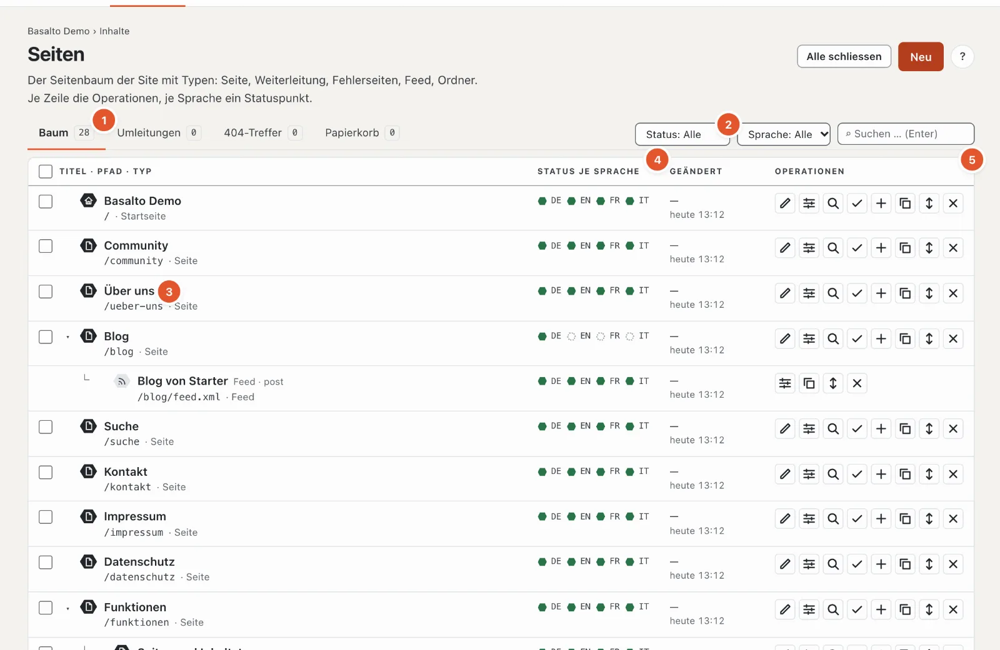
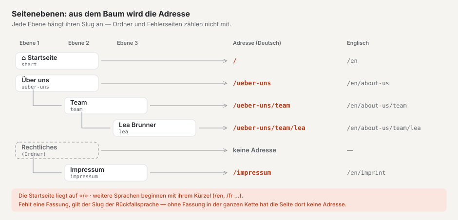
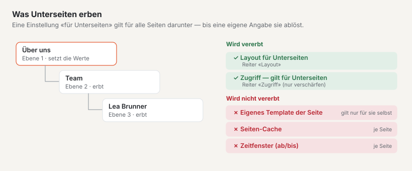
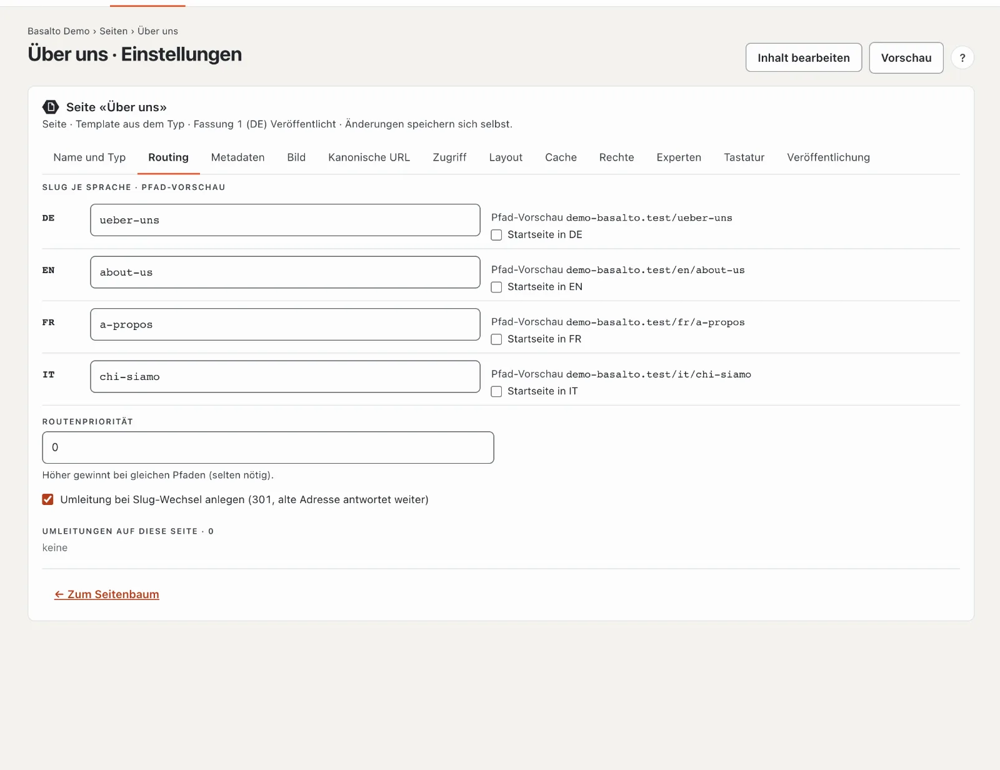
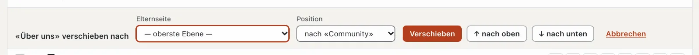

# Seiten und Seitenbaum

Der Seitenbaum zeigt alle Seiten der Website in ihrer Ordnung: oben die Hauptseiten, eingerückt darunter die
Unterseiten. Aus dem Baum entstehen die **Adressen** der Seiten, die **Menüs** und die **Brotkrumen** («Start › Über uns
› Team»). Wo eine Seite im Baum steht, ist darum mehr als Ordnung — es bestimmt, wie Besucher sie finden.

## Wo

Modus «Inhalte» › **Seiten**. Die Seite hat vier Reiter: «Baum», «Umleitungen», «404-Treffer» und «Papierkorb»; die Zahl
daneben sagt, wie viele Einträge es gibt.

## Der Baum

Jede Zeile zeigt **Titel**, **Pfad** und **Typ** (3), daneben je Sprache einen **Statuspunkt** (4) und rechts die
**Operationen** (5). Die Legende unter dem Baum erklärt die Punkte:

| Punkt | Bedeutung |
| --- | --- |
| grün gefüllt | Veröffentlicht — Besucher sehen diese Fassung |
| grün umrandet | Freigegeben oder geplant — wartet auf das Veröffentlichen |
| rot umrandet | In Prüfung — eingereicht, wartet auf die Freigabe |
| grau | Entwurf |
| gestrichelt | fehlt — in dieser Sprache gibt es noch keine Fassung |
| Marke «veraltet» | die Übersetzung beruht auf einer älteren Fassung der Standardsprache (siehe [Übersetzen](uebersetzen.md)) |

Unter dem Titel stehen je nach Lage Hinweise: «nicht veröffentlicht», «Ordner · nur Struktur», «Feed · Typ» oder bei einer
Weiterleitung «→ Ziel». Die **Startseite** trägt ein Haus-Symbol.

| Knopf (von links) | Was er tut |
| --- | --- |
| ✎ Inhalt bearbeiten | öffnet den Block-Editor der Seite (siehe [Inhalte mit Blöcken bearbeiten](bloecke.md)) |
| ☰ Einstellungen | öffnet Name, Adresse, Metadaten und die übrigen Reiter |
| ⌕ Vorschau | zeigt die neueste Fassung so, wie sie aussehen wird |
| ✓ Freigabe | öffnet die Freigabe dieser Seite (siehe [Freigabe und Veröffentlichung](freigabe.md)) |
| ＋ Unterseite | legt eine neue Seite **unter** dieser an |
| ⧉ Kopieren | legt eine Kopie direkt dahinter an |
| ↕ Verschieben | öffnet die Zeile zum Verschieben (Elternseite und Position) |
| ✕ Löschen | legt die Seite samt Unterseiten in den Papierkorb |

Ordner, Feeds und Fehlerseiten haben weniger Knöpfe — sie haben keinen Inhalt aus Blöcken.

**Filtern** (2): nach Status und Sprache wirkt sofort, die Suche (über die Titel aller Sprachen und den Pfad) mit Enter.
Die Elternseiten eines Treffers bleiben blass sichtbar, damit Sie sehen, wo er steht; der Statusfilter blendet Ordner
aus. «Filter zurücksetzen» zeigt wieder alles. Mit «Alle schliessen» bzw. «Alle öffnen» klappen Sie die Unterseiten zu
oder auf; der Pfeil vor einer Zeile klappt nur deren Unterseiten.

## Seitenebenen: wie aus dem Baum die Adresse wird

Jede Seite liegt auf einer **Ebene**: Seiten ohne Elternseite auf Ebene 1 («— oberste Ebene —»), ihre Unterseiten auf
Ebene 2, deren Unterseiten auf Ebene 3 — so tief, wie Sie wollen; eine Grenze gibt es nicht. Im Baum ist jede Ebene ein
Stück weiter eingerückt und mit «└» an die Elternseite gehängt.

Die **Adresse** (der Pfad) einer Seite besteht aus den Slugs aller Elternseiten und ihrem eigenen Slug, getrennt durch
«/». Der Slug ist der Teil der Adresse, den Sie im Reiter «Routing» je Sprache eintragen.

- Nur **Seiten, Weiterleitungen und Feeds** tragen einen Teil zur Adresse bei. **Ordner** und **Fehlerseiten** werden
  übersprungen: das Impressum im Ordner «Rechtliches» liegt unter `/impressum`, nicht unter `/rechtliches/impressum`.
- Die **Startseite** liegt auf `/`; ihre Unterseiten hängen direkt darunter (`/kontakt`, nicht `/start/kontakt`).
- **Weitere Sprachen** beginnen mit ihrem Kürzel: `/en/about-us/team`. Jede Sprache hat ihre eigenen Slugs.
- **Fehlt eine Fassung** in einer Sprache, gilt der Slug der Rückfallsprache (siehe [Übersetzen](uebersetzen.md#fallback-sprache));
  gibt es in der ganzen Kette keine Fassung, hat die Seite in dieser Sprache keine Adresse — die Pfad-Vorschau sagt dann
  «Pfad … noch nicht bekannt».

Wofür die Ebenen gut sind:

- **Adressen sprechen:** `/leistungen/laravel` sagt Besuchern und Suchmaschinen, wo sie sind.
- **Menüs** entstehen aus dem Baum (siehe unten), **Brotkrumen** auch.
- **Einstellungen vererben** sich nach unten (siehe [Was Unterseiten erben](#was-unterseiten-erben)).

Eine Seite eine Ebene tiefer legen Sie an, indem Sie in der Zeile der künftigen Elternseite auf **«＋ Unterseite»**
klicken oder beim Anlegen die **Elternseite** wählen. Eine bestehende Seite bringen Sie mit **«Verschieben»** auf eine
andere Ebene. Ändert sich dadurch die Adresse, leitet Basalto die alte Adresse automatisch um.

### Die Startseite

Je Sprache gibt es genau eine Startseite. Sie legen sie im Reiter «Routing» mit «Startseite in DE» (bzw. EN …) fest;
eine neue Startseite löst die alte ab. Ist keine gewählt, gilt in einer weiteren Sprache die Startseite der
Standardsprache, sonst die erste Seite auf der obersten Ebene.

### Was Unterseiten erben

- **«Layout für Unterseiten»** (Reiter «Layout») gilt für alle Seiten darunter, bis eine Seite selbst etwas anderes
  wählt.
- **Zugriff:** Schützen Sie eine Seite mit «gilt für Unterseiten», sind auch alle Seiten darunter geschützt; eine
  Unterseite kann den Schutz nicht aufheben (siehe [Mitglieder](mitglieder.md)).
- **Nicht** vererbt werden das eigene Template einer Seite, ihr Seiten-Cache und ihr Zeitfenster.

### Menüs und Brotkrumen

Welche Ebenen ein Menü zeigt, legt das Theme fest: ab welcher Ebene (Startebene) und wie viele Ebenen tief (meist eine).
Im Menü erscheinen nur Seiten, die Besucher sehen dürfen. Nicht im Menü stehen:

- Ordner — ihre Unterseiten rücken an ihre Stelle,
- Fehlerseiten und Feeds,
- Seiten ausserhalb ihres Zeitfensters und geschützte Seiten für Gäste,
- Seiten mit «Im Menü verstecken (bleibt erreichbar)» (Reiter «Experten») — **samt ihren Unterseiten**.

Eine Weiterleitung im Menü führt direkt auf ihr Ziel. Die **Brotkrumen** beginnen mit der Startseite, überspringen
Ordner und erscheinen erst ab zwei Einträgen.

## Eine Seite anlegen

1. Klicken Sie oben rechts auf **«Neu»** — oder in der Zeile der künftigen Elternseite auf «＋ Unterseite».
2. Wählen Sie den **Typ**. Er bestimmt, welche Reiter es gibt, und lässt sich später nicht mehr ändern:
   - **Seite** — eine normale Seite mit Inhalt aus Blöcken (12 Reiter).
   - **Weiterleitung** — leitet auf eine andere Seite der Site («intern») oder eine Adresse ausserhalb («extern») weiter
     (4 Reiter). Eine externe Weiterleitung kann je weitere Sprache eine eigene Adresse haben, etwa die englische
     Fassung einer Partnerseite; ein leeres Feld heisst «wie die Grundsprache».
   - **Fehlerseite 401, 403, 404, 503** — die Seite, die Besucher bei diesem Fehlercode sehen — zum Beispiel 404, wenn
     eine Adresse nicht gefunden wird (5 Reiter).
   - **Feed** — eine Liste der neuesten Einträge eines Inhaltstyps als RSS 2.0 oder Atom 1.0 (6 Reiter).
   - **Ordner** — gliedert den Baum, hat selbst keine Adresse und keinen Inhalt (3 Reiter: Name, Zugriff, Rechte).
3. Tragen Sie im Reiter «Name und Typ» den **Namen je Sprache** ein (höchstens 200 Zeichen) und wählen Sie die
   **Elternseite**. Der Name erscheint im Baum und in Menüs.
4. Klicken Sie auf **«Speichern»** (oder «Speichern und neu» für die nächste Seite, «Speichern und schliessen» zurück
   zum Baum).

Mit dem Speichern entsteht die erste Fassung — als Entwurf in jeder Sprache, für die Sie einen Namen eingetragen haben.
Den eigentlichen Inhalt schreiben Sie danach über «✎ Inhalt bearbeiten» im Block-Editor. Stimmt etwas nicht, steht oben
«N Angaben stimmen nicht» mit der Liste der betroffenen Reiter; ein Klick springt hin.

Beim späteren Bearbeiten der Einstellungen gibt es keinen Speichern-Knopf mehr: **Änderungen speichern sich selbst.**
Ein Häkchen «✓ gespeichert» bestätigt es.

### Regeln für den Slug

- Erlaubt sind Kleinbuchstaben a–z, Ziffern und «-» (nicht am Anfang), höchstens 200 Zeichen; für Feeds und Sitemaps
  darf er auf `.xml` enden.
- Lassen Sie ihn leer, bildet Basalto ihn aus dem Namen («Über uns» → `ueber-uns`).
- Ist die Adresse in dieser Sprache schon vergeben, schlägt Basalto eine freie vor («…-2»).

## Die Reiter der Einstellungen

| Reiter | Inhalt |
| --- | --- |
| Name und Typ | Name je Sprache, Elternseite; bei Weiterleitung und Feed deren Ziel bzw. Quelle |
| Routing | Slug je Sprache mit **Pfad-Vorschau**, Startseite je Sprache, Routenpriorität, Umleitung bei Slug-Wechsel, Umleitungen auf diese Seite |
| Metadaten | Seitentitel (höchstens 70 Zeichen) und Beschreibung (160) je Sprache mit Suchergebnis-Vorschau, Robots |
| Bild | Seitenbild für das Teilen in sozialen Netzen und für Listen, mit Fokuspunkt und Alt-Text |
| Kanonische URL | automatisch oder eine eigene Adresse |
| Zugriff | Seite schützen — nur für angemeldete Mitglieder, auf Wunsch samt Unterseiten (Modul «Mitglieder», siehe [Mitglieder](mitglieder.md)) |
| Layout | Template der Seite (aus dem Typ oder ein eigenes) und «Layout für Unterseiten» |
| Cache | Seiten-Cache für diese Seite ein oder aus, Dauer im Browser und in Zwischenspeichern (0 bis 31'536'000 Sekunden) |
| Rechte | verantwortliche Person und Rollen der Seite — massgebend für Berechtigungen bleiben die Rollen der Site |
| Experten | Sichtbarkeit in HTML-Sitemap, Suchindex und Menü; CSS-Klasse |
| Tastatur | ein Zeichen (a–z oder 0–9, je Site eindeutig): Besucher springen mit Alt bzw. Ctrl+Alt + Zeichen zur Seite |
| Veröffentlichung | Status der Fassung je Sprache; Zeitfenster «Anzeigen ab» und «Anzeigen bis» (Format JJJJ-MM-TT HH:MM) |

**Routenpriorität:** Führen zwei Inhalte auf dieselbe Adresse — zum Beispiel eine Seite und ein Inhalt mit eigener
Route —, gewinnt der mit der höheren Zahl; bei Gleichstand der erste im Baum. Selten nötig.

**Zeitfenster:** Ausserhalb des Zeitfensters antwortet die Seite mit «nicht gefunden» und fehlt in Menüs, Sitemap und
Suche — die Fassung bleibt aber veröffentlicht.

## Verschieben

- **Ziehen:** Fassen Sie eine Zeile irgendwo an und ziehen Sie sie an den neuen Platz. Wo Sie loslassen, entscheidet:
  im **oberen Drittel** einer Zeile landet die Seite **davor**, im **unteren Drittel** **danach**, in der **Mitte**
  wird sie **Unterseite** dieser Zeile (nur bei Seiten und Ordnern).
- **Mit «↕ Verschieben»:** Die Zeile öffnet sich. Wählen Sie die neue **Elternseite** und die **Position** («am Anfang»
  oder «nach …») und bestätigen Sie mit «Verschieben». Für kleine Schritte gibt es «↑ nach oben» und «↓ nach unten»;
  «Abbrechen» schliesst die Zeile.

Nicht möglich ist: eine Seite unter sich selbst oder eine ihrer Unterseiten zu legen, unter eine Weiterleitung, einen
Feed oder eine Fehlerseite (Elternseiten sind nur Seiten und Ordner) — und ohne Recht auf die Standardsprache.

Ändert sich dadurch die Adresse einer Seite, legt Basalto automatisch eine **Umleitung** von der alten auf die neue
Adresse an — auch für alle Unterseiten. Dasselbe geschieht, wenn eine Seite mit neuem Slug veröffentlicht wird.
Abschalten lässt sich das je Seite im Reiter «Routing» («Umleitung bei Slug-Wechsel anlegen»).

## Kopieren

«⧉ Kopieren» fragt «Kopie anlegen?». Mit «Ja» entsteht direkt unter dem Original eine Seite desselben Typs mit denselben
Einstellungen. Der Titel erhält den Zusatz «(Kopie)», der Slug endet auf «-kopie», und jede Sprache beginnt als
Entwurf. **Unterseiten werden nicht mitkopiert.**

## Löschen und Papierkorb

«✕ Löschen» fragt nach und legt die Seite **mit allen Unterseiten** in den Papierkorb. Auf der Website sind sie danach
nicht mehr erreichbar.

Im Reiter **«Papierkorb»** steht jede gelöschte Seite mit Typ, Löschdatum und — wenn sie Unterseiten hatte — «mit N
Unterseiten». **«Wiederherstellen»** legt die Seite samt diesen Unterseiten an ihren alten Platz im Baum zurück. Eine
Unterseite, die Sie schon vorher einzeln gelöscht hatten, bleibt im Papierkorb, bis Sie sie selbst wiederherstellen.

## Mehrere Seiten auf einmal

Setzen Sie die Häkchen vor den gewünschten Zeilen (nur Zeilen vom Typ «Seite», höchstens 500; das Häkchen im Kopf wählt
alle). Oben erscheint die Sammelaktion:

- **«Einreichen»** — schickt alle Entwürfe der gewählten Seiten in die Freigabe (nur, wenn alle Pflichtfelder
  ausgefüllt sind).
- **«Veröffentlichen»** — veröffentlicht Fassungen, die bereits freigegeben oder geplant sind. Ist das Ihrer Rolle nicht
  erlaubt, weist das Backend darauf hin.
- **«Löschen»** — legt die Seiten in den Papierkorb.
- «Auswahl aufheben» entfernt alle Häkchen.

Was nicht möglich war, nennt die Meldung danach mit Titel (die ersten fünf).

## Umleitungen

Der Reiter **«Umleitungen»** listet die Weiterleitungen von alten Adressen (die 500 neuesten). Die Spalte «Herkunft»
sagt, wie sie entstanden sind: «automatisch» (beim Verschieben oder Slug-Wechsel), «von Hand» oder «Import».

**Eine Umleitung von Hand anlegen:**

1. Bei **«Alte Adresse»** den Pfad eintragen, zum Beispiel «/alte-seite».
2. Bei **«Ziel»** die neue Adresse eintragen («/neue-seite» oder eine vollständige Adresse mit https://).
3. Den Status wählen: **301 dauerhaft**, **302 vorübergehend** oder **410 entfernt** (ohne Ziel — die Adresse meldet
   dann «gibt es nicht mehr»).
4. **«Anlegen»** klicken. Gibt es für die alte Adresse schon eine Umleitung, wird sie ersetzt.

Viele Umleitungen auf einmal übernehmen Sie mit **«CSV importieren …»**: je Zeile «alte Adresse; Ziel; Status»
(Semikolon, Komma oder Tabulator; leerer Status bedeutet 301), höchstens 2 MB und 5000 Zeilen. Fehlerhafte Zeilen nennt
die Meldung danach (die ersten 50). Ketten (A → B → C) löst Basalto selbst auf: A führt direkt nach C.

Bestehende Umleitungen ändern Sie direkt in der Zeile mit «Bearbeiten»: Enter oder Verlassen des Feldes speichert, Esc
bricht ab. «Entfernen» löscht die Umleitung — die alte Adresse antwortet danach mit «nicht gefunden». Die Spalte
«Treffer» zeigt, wie oft eine Umleitung schon gebraucht wurde.

## 404-Treffer

Der Reiter **«404-Treffer»** zeigt Adressen, die Besucher aufgerufen haben, die es aber nicht gibt — die häufigsten
zuerst (bis 200), mit Anzahl, erstem und letztem Treffer und der Seite, von der sie kamen.

- **«Umleitung anlegen»** — tragen Sie das Ziel ein; die Zeile ist damit erledigt.
- **«Verwerfen»** — entfernt die Zeile. Wird die Adresse wieder aufgerufen, zählt sie neu.

Adressen ohne neue Treffer löscht ein nächtlicher Löschlauf nach 90 Tagen (die Frist lässt sich unter «Verwaltung ›
Einstellungen», Gruppe «Aufbewahrung», ändern). Gibt es offene 404-Treffer, erscheint auf der «Übersicht» eine Aufgabe
dazu.

## Häufige Fragen

**Ich finde den Slug nicht im Editor.**
Slug, Metadaten und Sichtbarkeit einer Seite stehen in den Einstellungen («☰ Einstellungen», Reiter «Routing» und
«Metadaten»), nicht im Block-Editor.

**Kann ich den Typ einer Seite ändern?**
Nein, der Typ bleibt nach dem Anlegen. Legen Sie eine neue Seite mit dem gewünschten Typ an und verschieben Sie die
Unterseiten.

**Ich habe eine Seite verschoben — sind alte Links jetzt kaputt?**
Nein. Die automatische Umleitung führt Besucher und Suchmaschinen zur neuen Adresse. Sie sehen sie im Reiter
«Umleitungen».

**Warum steht meine Seite nicht im Menü?**
Prüfen Sie: Liegt sie auf einer Ebene, die das Menü des Themes zeigt? Ist «Im Menü verstecken (bleibt erreichbar)» gesetzt — bei ihr oder
einer Elternseite? Ist sie veröffentlicht und im Zeitfenster? Ist sie geschützt und Sie schauen als Gast?

**Wozu Ordner statt Seiten?**
Ein Ordner gruppiert Seiten im Baum, ohne die Adresse zu verlängern — gut für «Rechtliches» mit Impressum und
Datenschutz, die trotzdem unter `/impressum` und `/datenschutz` liegen sollen.

## Weiter

- [Inhalte mit Blöcken bearbeiten](bloecke.md)
- [Freigabe und Veröffentlichung](freigabe.md)
- [Menüs](../einrichtung/menues.md)
