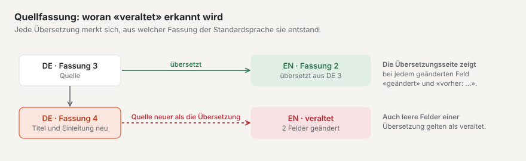
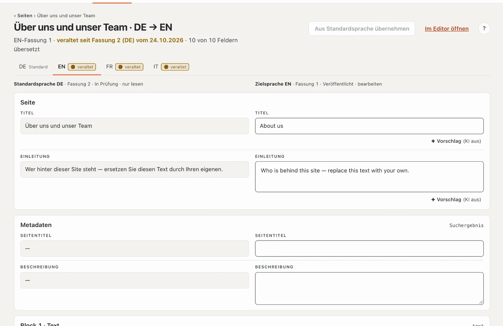
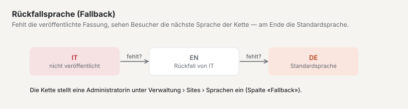
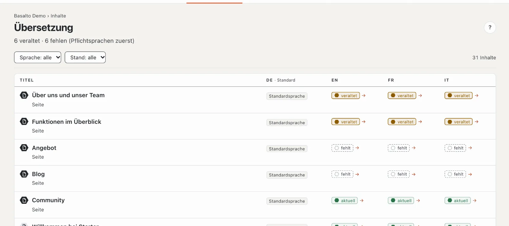

# Übersetzen

Hat Ihre Site mehrere Sprachen, entsteht jede Übersetzung aus der **Standardsprache**. Basalto merkt sich, auf welcher Fassung der Standardsprache eine Übersetzung beruht, und zeigt Ihnen, wenn sich dort seither etwas geändert hat.

## Wo

- Modus «Inhalte» › **Übersetzung** — die Liste aller Inhalte mit fehlenden oder veralteten Übersetzungen.
- Im Editor eines Inhalts in einer anderen Sprache als der Standardsprache: **«Übersetzen nebeneinander»**.

## Was übersetzt wird

Übersetzt werden die Texte: Titel, Einleitung, Seitentitel und Beschreibung sowie die Text- und Fliesstext-Felder, die das Theme als übersetzbar kennzeichnet.

Alles andere — zum Beispiel Bilder, Zahlen oder Auswahlfelder — ist **geteilt**: Es gilt für alle Sprachen und wird nur in der Standardsprache gepflegt. Solche Felder tragen die Marke «geteilt».

## Der Stand einer Übersetzung

| Stand | Bedeutung |
| --- | --- |
| **aktuell** | die Übersetzung passt zur neuesten Fassung der Standardsprache, und alle übersetzbaren Felder sind gefüllt |
| **veraltet** | ein übersetzbares Feld der Standardsprache hat sich seit der Übersetzung geändert — oder in der Übersetzung sind Felder leer, die in der Standardsprache Text haben |
| **fehlt** | in dieser Sprache gibt es noch keine Fassung |

Ein neues Bild allein macht eine Übersetzung nicht veraltet — nur geänderter Text.

## Eine Übersetzung anlegen

1. Öffnen Sie die Übersetzung — über die Liste «Übersetzung» (ein Klick auf den Stand der Sprache in der Zeile) oder im Editor über «Übersetzen nebeneinander».
2. Gibt es in der Zielsprache noch keine Fassung, klicken Sie auf **«Übersetzung aus … anlegen»**. Basalto legt einen Entwurf an, der auf der aktuellen Fassung der Standardsprache beruht. Ohne Recht auf diese Sprache oder ohne Fassung der Standardsprache ist der Knopf gesperrt.
3. Übersetzen Sie Feld für Feld: **links** der Text der Standardsprache (nur lesen), **rechts** Ihr Feld in der Zielsprache. Die Spaltenköpfe nennen Sprache, Fassung, Status und «nur lesen» bzw. «bearbeiten». Die Felder sind nach Abschnitten gegliedert: Seite (Titel, Einleitung), Metadaten (Seitentitel, Beschreibung) und je Block einer. Unter 1024 px Breite stehen Quelle und Ziel untereinander.
4. Gespeichert wird automatisch gut eine Sekunde nach der letzten Eingabe, sobald der Titel übersetzt ist. Ein «✓ gespeichert» am Feld bestätigt es. Text-Felder fassen höchstens 300 Zeichen, Textbereiche 5000; stimmt etwas nicht, steht oben «N Felder stimmen nicht». Ob Sie die Sprache bearbeiten dürfen, prüft Basalto beim Speichern.

Ein leeres Zielfeld hat einen gestrichelten Rand und den Hinweis «Übersetzung fehlt …».

Hilfreich:

- **«→ übernehmen»** an einem leeren Feld kopiert den Text der Standardsprache in Ihr Feld — praktisch für Namen oder Fachbegriffe, die gleich bleiben.
- **«Aus Standardsprache übernehmen»** oben füllt alle noch leeren Felder mit dem Text der Standardsprache.
- **«Vorschlag»** an einem Feld lässt die KI übersetzen, wenn das Modul «KI-Vorschläge» eingerichtet ist (siehe [KI-Vorschläge](ki.md)); sonst steht dort «(KI aus)».
- Der Zähler «… von … Feldern übersetzt» zeigt, wie weit Sie sind; Felder, die in der Standardsprache leer sind, zählen nicht mit.

## Eine veraltete Übersetzung nachführen

Ist eine Übersetzung veraltet, zeigt die Übersetzungsseite oben «veraltet seit Fassung … vom …». Die geänderten Felder tragen die Marke **«geändert»** und zeigen unter «vorher:» den früheren Text der Standardsprache. So sehen Sie genau, was neu ist, und passen nur diese Stellen an.

## Einreichen und freigeben

Jede Sprache hat ihre eigenen Fassungen und durchläuft die Freigabe für sich. Ist die Übersetzung fertig, reichen Sie sie ein — über «Im Editor öffnen» und dort «Einreichen». Ist die Fassung der Zielsprache schon eingereicht oder veröffentlicht, legt das Speichern einen neuen Entwurf an; die live Fassung bleibt online. Mehr dazu unter [Freigabe und Veröffentlichung](freigabe.md).

## Pflichtsprachen

Eine **Pflichtsprache** muss vorhanden sein, bevor ein Inhalt freigegeben werden kann. Die Standardsprache ist immer Pflicht. Fehlt eine Pflichtsprache, sperrt die Freigabe mit dem Hinweis «Freigabe erst mit allen Pflichtsprachen — es fehlen: …». Als vorhanden gilt eine Sprache, sobald sie mindestens eingereicht ist.

In den Sprachreitern oben steht bei Pflichtsprachen «Pflicht». Fehlende oder veraltete Übersetzungen in Pflichtsprachen erscheinen ausserdem als Aufgabe auf der «Übersicht».

## Fallback-Sprache

Fehlt in einer Sprache die veröffentlichte Fassung, sehen Besucherinnen und Besucher die Fassung der **Fallback-Sprache** — und wenn auch dort keine ist, die nächste in der Kette bis zur Standardsprache. Die Übersetzungsseite weist darauf hin («Besucher sehen den Fallback …»).

Welche Sprachen Pflicht sind und welche Fallback-Sprache gilt, legt eine Administratorin oder ein Administrator fest: «Verwaltung › Sites», Site öffnen, Reiter **«Sprachen»** (Spalten «Standard», «Pflicht» und «Fallback»).

## Die Übersicht «Übersetzung»

Oben steht «N veraltet · N fehlen». Die Liste zeigt je Inhalt (Seiten und Inhalte, bis 500) den Stand in jeder Sprache: zuerst Inhalte mit Lücken in **Pflichtsprachen**, dann solche mit Lücken in weiteren Sprachen, dann der Rest — je Stufe zuletzt geänderte zuerst. Der Kopf jeder Spalte nennt «Standard» oder «Pflicht»; ein Sechseck vor dem Titel unterscheidet Seite und Inhalt. Filtern Sie nach **Sprache** (die Standardsprache ist nicht wählbar) und nach **Stand** («veraltet» oder «fehlt»); «Filter zurücksetzen» zeigt wieder alles. Ein Klick auf den Stand einer Sprache öffnet die Übersetzung. Ist alles erledigt, heisst es «Alles übersetzt», bei einem Filter ohne Treffer «Keine Treffer».

Die Zahl neben «Übersetzung» im Menü zeigt, wie viel noch offen ist.

## Häufige Fragen

**Kann ich auch direkt im normalen Editor übersetzen?**
Ja. Im Editor der Zielsprache legt «Übersetzung aus … anlegen» einen Entwurf mit den Blöcken der Standardsprache an, den Sie dann überschreiben. Die Ansicht «Übersetzen nebeneinander» ist aber übersichtlicher, weil der Ausgangstext direkt über Ihrem Feld steht.

**Ich kann ein Feld nicht bearbeiten.**
Steht «Gilt für alle Sprachen — wird in der Standardsprache gepflegt», ist das Feld geteilt. Ändern Sie es im Editor der Standardsprache. Steht im Spaltenkopf «nur lesen», erlaubt Ihre Rolle diese Sprache nicht (Rollen können auf bestimmte Sprachen beschränkt sein).

**Warum ist meine Übersetzung «veraltet», obwohl ich nichts geändert habe?**
Jemand hat in der Standardsprache einen übersetzbaren Text geändert — die Marke «geändert» zeigt Ihnen, welches Feld. Oder in Ihrer Übersetzung ist ein Feld leer, das in der Standardsprache Text hat.

## Weiter

- [Freigabe und Veröffentlichung](freigabe.md)
- [Die Site](../einrichtung/site.md)
