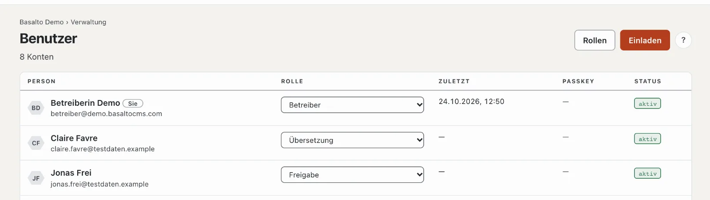
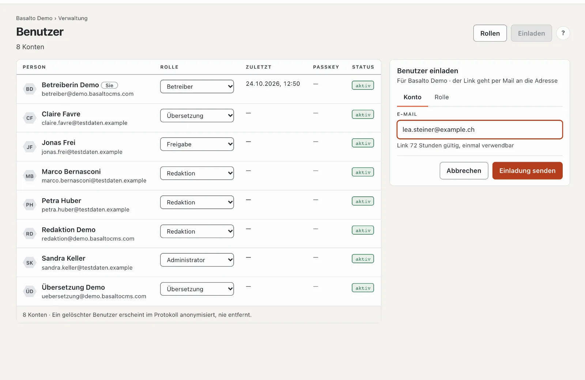
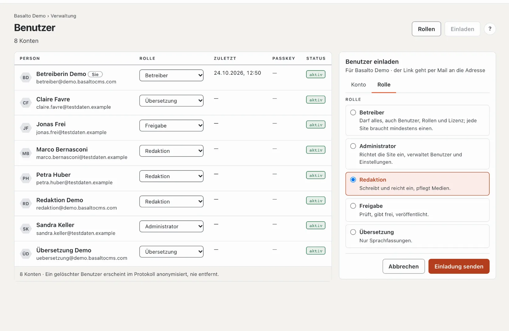
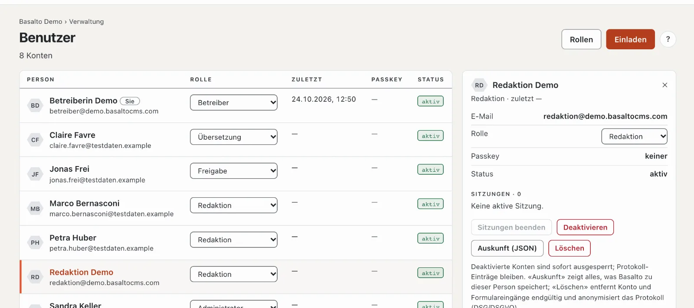

# Benutzer

Unter **Benutzer** sehen Sie alle Personen mit Zugang zur aktuellen Site, laden neue ein und vergeben Rollen. Hier deaktivieren Sie Konten, beenden Sitzungen und erfüllen Anfragen nach Auskunft und Löschung.

## Wo

Modus «Verwaltung» › **Benutzer**.

Je Person eine Zeile mit Name und E-Mail («Sie» markiert Ihr eigenes Konto), **Rolle** in dieser Site, **Zuletzt** (letzte Anmeldung), **Passkey** (wie viele) und **Status** («aktiv», «deaktiviert», «eingeladen»). Ein Klick auf eine Zeile öffnet die Personenkarte rechts. Oben führt **«Rollen»** zur [Rollen-Matrix](rollen.md).

## Jemanden einladen

1. **«Einladen»** öffnet rechts die Karte «Benutzer einladen» für die aktuelle Site.
2. Reiter **Konto**: die **E-Mail-Adresse**. Der Link in der Einladung ist **72 Stunden gültig und einmal verwendbar** (die Frist stellen Sie unter [Einstellungen](einstellungen.md), Gruppe «Anmeldung», ein).
3. Reiter **Rolle**: die Rolle wählen — jede mit einem Satz, was sie darf.
4. **«Einladung senden»**.

Die Person öffnet den Link und ist damit angemeldet; künftig meldet sie sich mit einem Code per Mail oder einem Passkey an. Bis dahin steht sie mit «eingeladen» in der Liste, mit «gültig bis …» und «eingeladen von …». Eine erneute Einladung an dieselbe Adresse ersetzt die offene.

Bei einer offenen Einladung:

- **«Erneut senden»** — ein neuer Link, die Frist beginnt neu.
- **«Zurückziehen»** — nach der Rückfrage «Zurückziehen?» mit «Ja» ist der Link ungültig.
- Ist die Frist vorbei, steht «eingeladen · abgelaufen». Senden Sie die Einladung erneut.

Gehört die Adresse schon zu dieser Site, lehnt Basalto die Einladung ab — die Rolle ändern Sie dann in der Liste. Hat die Person ein Konto in einer anderen Site, bekommt sie mit der Einladung zusätzlich eine Rolle in dieser.

## Die Rolle ändern

Wählen Sie in der Spalte **Rolle** eine andere — die Änderung gilt sofort und steht im Protokoll. Dabei gelten zwei Regeln:

- **Keine Rechte verschenken:** Sie vergeben nur Rollen, die nicht mehr dürfen als Sie selbst. Die Rolle «Betreiber» vergibt nur ein Betreiber.
- **Mindestens ein Betreiber:** Den letzten Betreiber einer Site kann niemand herabstufen.

## Die Personenkarte

Die Karte zeigt E-Mail, Rolle, Passkeys, Status und die **Sitzungen** (wo die Person gerade angemeldet ist). Darunter:

- **«Sitzungen beenden»** — meldet die Person überall ab, zum Beispiel nach einem verlorenen Gerät.
- **«Deaktivieren»** — sperrt das Konto: Alle Sitzungen enden sofort, Anmelden geht nicht mehr. Nach der Rückfrage «… deaktivieren?» mit «Ja, deaktivieren». **«Aktivieren»** hebt es wieder auf. Protokoll-Einträge bleiben. Das eigene Konto lässt sich nicht deaktivieren; eigene Sitzungen beenden Sie im Profil.
- **«Auskunft (JSON)»** — alles, was Basalto zu dieser Person speichert, als Datei: für eine Anfrage nach DSG/DSGVO.
- **«Löschen»** — entfernt das Konto und die Formulareingänge mit dieser E-Mail-Adresse **endgültig**; im Protokoll bleibt kein Name, die Einträge erscheinen anonymisiert. Das lässt sich nicht rückgängig machen.

Die **E-Mail-Adresse** einer Person lässt sich derzeit im Backend nicht ändern; legen Sie bei einem Wechsel ein neues Konto an und löschen Sie das alte.

## Häufige Fragen

**Die Einladung kommt nicht an.**
Prüfen Sie den Spam-Ordner und ob die Installation Mails verschicken kann (siehe [Betrieb](betrieb.md)). Mit «Erneut senden» geht ein neuer Link hinaus.

**Ich kann einer Person die Rolle «Administrator» nicht geben.**
Ihre eigene Rolle darf weniger als ein Administrator — Rechte, die man selbst nicht hat, vergibt man nicht.

**Deaktivieren oder löschen?**
Deaktivieren, solange die Person vielleicht zurückkommt oder ihre Spuren nachvollziehbar bleiben sollen. Löschen nur auf Anfrage nach DSG/DSGVO — es ist endgültig.

## Weiter

- [Rollen](rollen.md)
- [Protokoll](protokoll.md)
