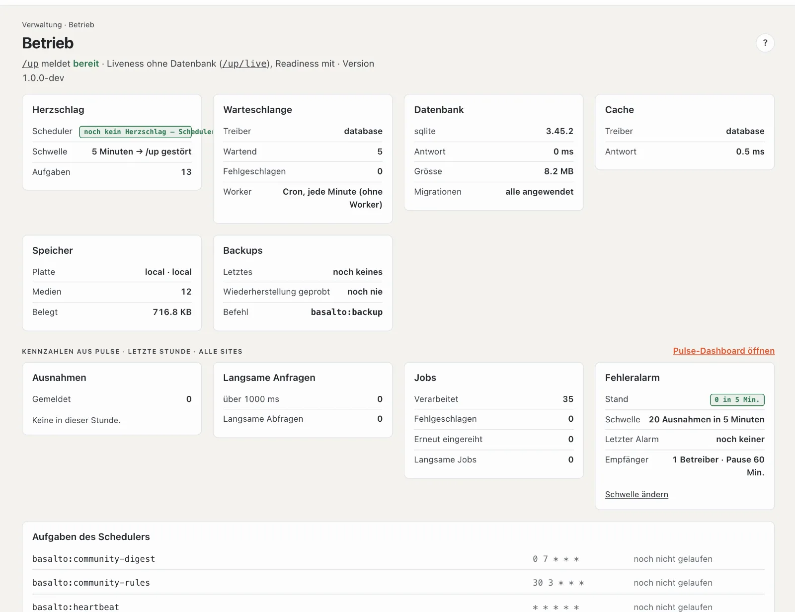

# Betrieb

**Betrieb** zeigt auf einen Blick, ob die Installation gesund ist: läuft der Zeitplan, arbeitet die Warteschlange, antwortet die Datenbank, gibt es Sicherungen, häufen sich Fehler. Rot heisst: Hier stimmt etwas nicht — meist ist dann die Technik gefragt.

## Wo

Modus «Verwaltung» › **Betrieb**.

Oben steht, was die Statusadresse `/up` meldet: **«bereit»** heisst, die Site läuft und alle Dienste antworten; **«gestört»** heisst, etwas fehlt (zum Beispiel der Herzschlag). Externe Überwachung fragt genau diese Adresse ab. Dazu die Version von Basalto.

## Die Karten

| Karte | Was sie zeigt | Rot heisst | Was tun |
| --- | --- | --- | --- |
| **Herzschlag** | ob der Zeitplan (Scheduler) läuft, die Schwelle und wie viele Aufgaben er hat | kein Herzschlag seit der Schwelle — geplante Veröffentlichungen, Löschlauf und Sicherungen laufen nicht | Technik: den Scheduler (Cron, jede Minute) prüfen |
| **Warteschlange** | Treiber, wartende und fehlgeschlagene Jobs, wie sie abgearbeitet werden | mindestens ein Job ist fehlgeschlagen | siehe unten |
| **Datenbank** | Art, Version, Antwortzeit, Grösse und ob alle Migrationen eingespielt sind | keine Verbindung oder offene Migrationen | Technik: nach einem Update `php artisan migrate` |
| **Cache** | Treiber und Antwortzeit | keine Antwort | Technik |
| **Speicher** | Ablage der Medien, Anzahl und belegter Platz | Speicher nicht erreichbar | Technik |
| **Backups** | letzte Sicherung, wann eine Wiederherstellung zuletzt geprobt wurde | keine Sicherung | «Backup jetzt» oder Technik |

Im Abo kommt die Karte **Kundendomains** dazu: der Stand der eigenen Domains.

### Fehlgeschlagene Jobs

Jobs sind Arbeiten im Hintergrund — Bildvarianten schneiden, Mails verschicken, Seiten vorwärmen. Scheitert einer, steht er in der Karte «Warteschlange» mit Name und Grund, und auch die «Übersicht» weist darauf hin. Mit **«Noch einmal versuchen»** kommt er wieder in die Warteschlange; **«Verwerfen»** entfernt ihn. Beides steht im Protokoll. Scheitert ein Job immer wieder, liegt die Ursache tiefer — geben Sie den Grund an die Technik weiter.

### Backups

**«Backup jetzt»** startet eine Sicherung der ganzen Installation (Datenbank und Medien) im Hintergrund; ab Werk läuft sie jede Nacht, und die letzten 7 bleiben (Einstellung «Sicherungen behalten»). **Wiederherstellen** kann nur die Technik (siehe [Backup](../betrieb/backup.md)).

Ein Backup sichert die ganze Installation für den Notfall. Der **Export** einer Site (unter «Sites») ist etwas anderes: eine Kopie einer einzelnen Site zum Umziehen.

## Stand der Installation

Unten links auf jeder Seite steht klein der Stand: ein farbiges Abzeichen für die Umgebung — **PROD** (rot),
**TESTING** (bernstein), **DEMO** (blau), **LOKAL** (grün) —, dazu die Version und wann sie ausgeliefert wurde. Mit der
Maus darüber zeigt es den Commit. Auf der Website sehen ihn in der Produktion nur Personen, die im Backend angemeldet
sind; Besuchende sehen keine Versionsnummer.

## Kennzahlen und Fehleralarm

Wer die Installation betreibt, sieht darunter **Kennzahlen der letzten Stunde** über alle Sites — gemeldete Ausnahmen, langsame Anfragen und Abfragen, Jobs — und **«Pulse-Dashboard öffnen»** für Einzelheiten.

Die Karte **Fehleralarm** zeigt, ab wie vielen Fehlern in wie vielen Minuten eine Mail an Besitz und Verwaltung des Installationskontos geht, wann der letzte Alarm war und wer ihn bekommt. **«Schwelle ändern»** führt zu den [Einstellungen](einstellungen.md), Gruppe «Betrieb».

## Aufgaben des Schedulers

Unten die Liste aller geplanten Aufgaben mit ihrem Takt und wann sie zuletzt gelaufen sind — zum Beispiel Herzschlag (jede Minute), geplante Veröffentlichungen, Sicherung (nachts), Löschlauf, Lizenzprüfung. «noch nicht gelaufen» bei allen heisst meist: Der Scheduler läuft nicht.

## Häufige Fragen

**«kein Herzschlag» — ist die Website down?**
Nein, die Website läuft. Aber alles, was zeitgesteuert ist, steht still. Die Technik muss den Scheduler einrichten (siehe [Installation](../betrieb/installation.md)).

**Ich sehe die Kennzahlen aus Pulse nicht.**
Sie sind den Betreibern der Installation vorbehalten.

## Weiter

- [Monitoring](../betrieb/monitoring.md)
- [Updates](updates.md)
