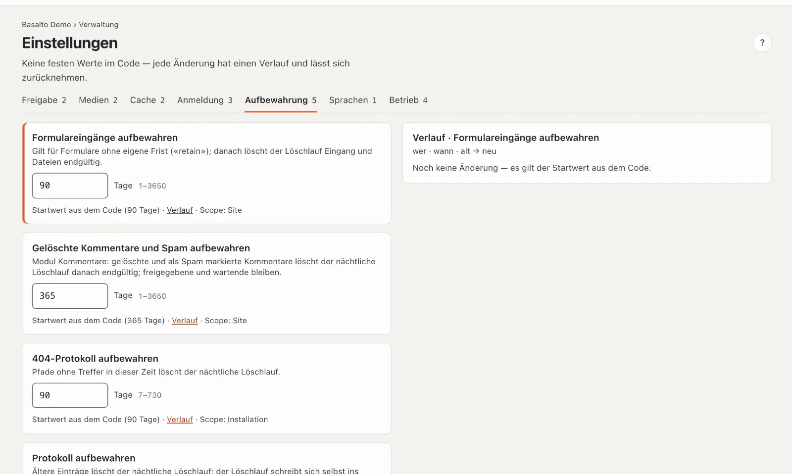
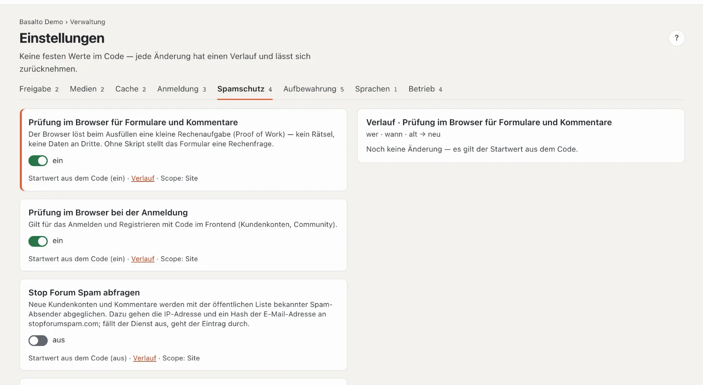

# Einstellungen

Unter **Einstellungen** stehen die Fristen, Schalter und Grenzen von Basalto — keine festen Werte im Code. Jede Änderung hat einen **Verlauf** und lässt sich zurücknehmen.

## Wo

Modus «Verwaltung» › **Einstellungen**. Oben je Gruppe ein Reiter mit der Zahl ihrer Werte: Freigabe, Medien, Cache, Anmeldung, Aufbewahrung, Sprachen, Betrieb.

Je Wert eine Karte:

- **Name** und was der Wert bewirkt.
- Das **Feld** — ein Schalter oder eine Zahl mit Einheit und erlaubter Spanne (zum Beispiel «Tage 1–3650»).
- Darunter: **«Startwert aus dem Code (…)»**, solange niemand ihn geändert hat, sonst **«Geändert von … am …»**; **«Verlauf»**; und **«Scope»** — ob der Wert für die ganze **Installation** gilt oder nur für diese **Site**.

Änderungen speichern sich selbst («speichert …», dann «gespeichert»). Liegt ein Wert ausserhalb der Spanne, steht der Fehler am Feld, und nichts wird gespeichert. Ohne Recht zum Bearbeiten sind die Felder gesperrt («nur lesen»).

## Verlauf und Zurücknehmen

**«Verlauf»** zeigt rechts jede Änderung dieses Werts: wer, wann, alt → neu. **«Wiederherstellen»** an einem Eintrag setzt den Wert auf diesen früheren Stand zurück — auch das steht danach im Verlauf und im [Protokoll](protokoll.md). Ohne Änderung heisst es «Noch keine Änderung — es gilt der Startwert aus dem Code».

## Alle Werte

| Gruppe | Einstellung | Vorgabe | Spanne | Gilt für | Wirkung |
| --- | --- | --- | --- | --- | --- |
| Freigabe | Vier-Augen-Prinzip | aus | — | Site | Einreichende dürfen ihre eigene Fassung nicht freigeben. |
| Freigabe | Archivierte Fassungen behalten | 50 | 0–1000 | Site | je Inhalt und Sprache; ältere archivierte Fassungen löscht der Löschlauf; 0 = alle behalten |
| Medien | Alt-Text Pflicht | aus | — | Site | Veröffentlichung ohne Alt-Text je Sprache wird abgewiesen (auch in den Einstellungen der Site). |
| Medien | Papierkorb der Mediathek | 30 Tage | 1–365 | Installation | danach löscht der Löschlauf Original und Varianten endgültig |
| Cache | Seiten-Cache | an | — | Site | Seiten kommen fertig aus dem Cache; jede Veröffentlichung macht ihn ungültig und wärmt die Seite vor. Einzelne Seiten nehmen Sie im Reiter «Cache» der Seite aus. |
| Cache | Seiten im Cache höchstens | 24 Stunden | 1–168 | Site | danach rendert die nächste Anfrage neu, auch ohne Änderung |
| Anmeldung | Gültigkeit des Anmeldecodes | 10 Minuten | 2–60 | Installation | wie lange der Code aus der Mail gilt |
| Anmeldung | Neuer Code frühestens nach | 30 Sekunden | 0–600 | Installation | so lange zählt «Code erneut senden» nach dem letzten Code herunter; 0 = sofort |
| Anmeldung | Gültigkeit von Einmal-Links | 60 Minuten | 5–1440 | Installation | Links aus Installer und Konsole |
| Anmeldung | Gültigkeit einer Einladung | 72 Stunden | 1–720 | Installation | siehe [Benutzer](benutzer.md) |
| Spamschutz | Prüfung im Browser für Formulare und Kommentare | an | an/aus | Site | Rechenaufgabe im Hintergrund (Proof of Work), ohne Rätsel; ohne Skript eine Rechenfrage |
| Spamschutz | Prüfung im Browser bei der Anmeldung | an | an/aus | Site | Anmelden und Registrieren mit Code im Frontend |
| Spamschutz | Stop Forum Spam abfragen | aus | an/aus | Site | neue Kundenkonten und Kommentare gegen die öffentliche Liste bekannter Spam-Absender; dazu gehen IP-Adresse und ein Hash der E-Mail-Adresse an stopforumspam.com |
| Spamschutz | Stop Forum Spam: Treffer ab | 80 Prozent | 1–100 | Site | Zuversicht der Liste, ab der ein Eintrag als Spam gilt |
| Statistik | Besuche zählen | an | an/aus | Site | Seitenaufrufe zählen und die Cookie-Einstellungen zeigen; Besucher und Sitzungen nur mit Einwilligung (siehe [Statistik](statistik.md)) |
| Aufbewahrung | Formulareingänge aufbewahren | 90 Tage | 1–3650 | Site | für Formulare ohne eigene Frist; danach löscht der Löschlauf Eingang und Dateien |
| Aufbewahrung | Gelöschte Kommentare und Spam aufbewahren | 365 Tage | 1–3650 | Site | Modul Kommentare; freigegebene und wartende bleiben |
| Aufbewahrung | 404-Protokoll aufbewahren | 90 Tage | 7–730 | Installation | Pfade ohne Treffer in dieser Zeit fallen weg |
| Aufbewahrung | Protokoll aufbewahren | 365 Tage | 30–3650 | Installation | ältere Einträge löscht der Löschlauf |
| Aufbewahrung | Statistik aufbewahren | 400 Tage | 30–1095 | Installation | ältere Seitenaufrufe löscht der Löschlauf |
| Aufbewahrung | Sicherungen behalten | 7 | 1–365 | Installation | ältere Sicherungen im selben Ordner fallen weg |
| Sprachen | Pflichtsprachen vor der Freigabe | — | — | Site | ein Verweis: Pflichtsprachen und Fallback stehen bei den Sprachen der Site («Öffnen →») |
| Betrieb | Herzschlag-Schwelle | 5 Minuten | 2–60 | Installation | ist der letzte Herzschlag älter, meldet die Statusadresse «gestört» |
| Betrieb | Fehleralarm ab | 20 Ausnahmen | 0–100'000 | Installation | so viele Fehler im Fenster lösen eine Mail an Besitz und Verwaltung des Installationskontos aus; 0 = kein Alarm |
| Betrieb | Fenster des Fehleralarms | 5 Minuten | 1–60 | Installation | über welche Zeit gezählt wird |
| Betrieb | Pause nach einem Fehleralarm | 60 Minuten | 5–1440 | Installation | so lange kommt keine weitere Mail |
| Betrieb | Nutzungsangaben an den Hersteller | an | an/aus | Installation | mit der Prüfung auf Updates gehen eine zufällige Kennung, die Version, PHP und die Art der Datenbank mit — keine Adressen, keine Inhalte (siehe [Updates](updates.md)) |

Der **Löschlauf** läuft jede Nacht und löscht, was die Fristen erreicht hat — endgültig. Er schreibt sich selbst ins Protokoll.

## Häufige Fragen

**Ein Wert gilt für die Installation — warum sehe ich ihn in jeder Site?**
Werte mit «Scope: Installation» gelten für alle Sites gleich; eine Änderung wirkt überall.

**Ich habe aus Versehen etwas geändert.**
Öffnen Sie den «Verlauf» und wählen Sie beim früheren Stand «Wiederherstellen».

## Weiter

- [Protokoll](protokoll.md)
- [Betrieb](betrieb.md)
