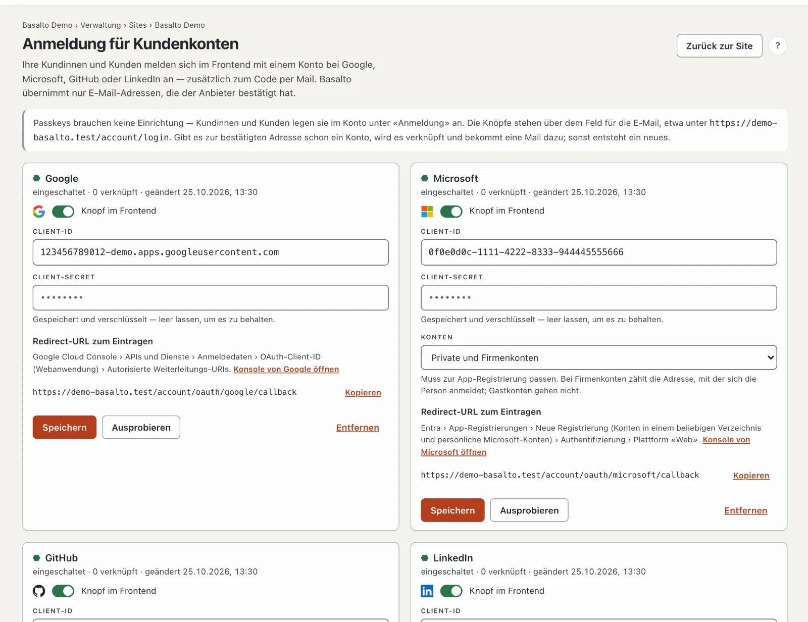
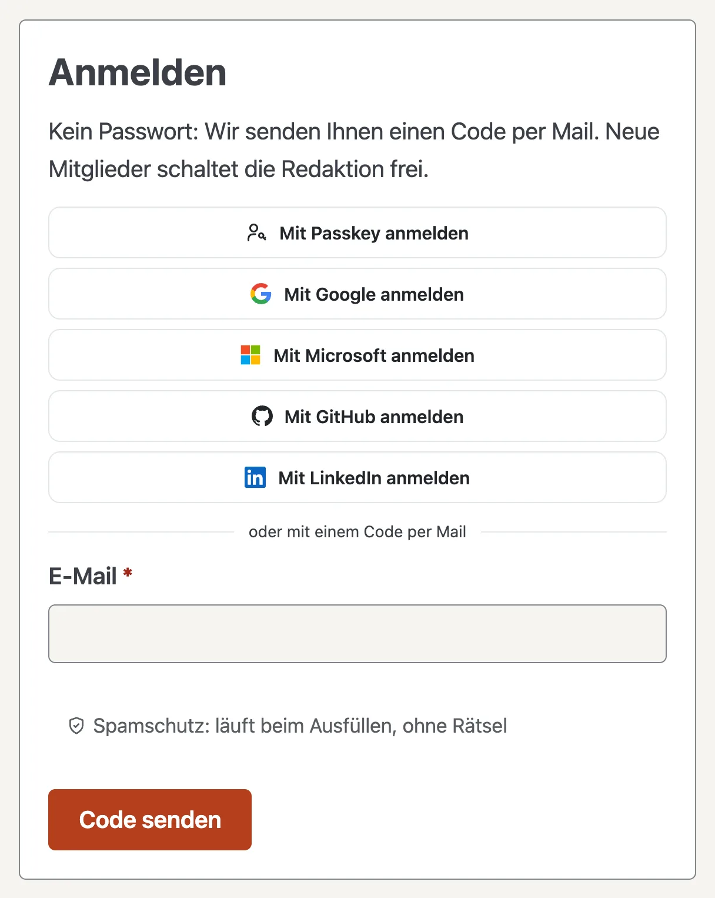

# Anmeldung für Kundenkonten

Ihre Kundinnen und Kunden melden sich im Frontend mit einem Passkey oder mit einem Konto bei Google, Microsoft, GitHub oder LinkedIn an — zusätzlich zum Code per Mail. Das gilt überall, wo das Kundenkonto im Spiel ist: Forum, Mitglieder, Lizenzkauf und Marktplatz.

## So sieht es im Frontend aus

Über dem Feld für die E-Mail stehen «Mit Passkey anmelden» und die Knöpfe der eingeschalteten Anbieter, darunter «oder mit einem Code per Mail».

- **Gibt es zur Adresse schon ein Kundenkonto,** meldet Basalto dort an und verknüpft beim ersten Mal das Konto beim Anbieter. Das Kundenkonto bekommt dazu eine Mail («Neue Anmeldung über Google»). Danach zählt die Kennung beim Anbieter — ändert jemand dort die Adresse, klappt die Anmeldung weiter.
- **Sonst entsteht ein neues Kundenkonto** — aber nur, wenn die Site neue Konten zulässt. Stehen die Mitglieder auf «nur auf Einladung», melden sich über einen Anbieter nur bestehende Konten an.
- **Im Konto** zeigt der Bereich **«Anmeldung»** die verknüpften Konten. **Verknüpfen** geht auch mit einem Konto, das eine andere Adresse hat; **Trennen** löst die Verbindung. Der Code per Mail geht immer.

## Passkeys

Passkeys brauchen keine Einrichtung. Wer angemeldet ist, legt im Konto unter **«Anmeldung» › Passkey hinzufügen** einen an — bestätigt mit Fingerabdruck, Gesicht oder Gerätesperre. Danach genügt **«Mit Passkey anmelden»**, ganz ohne Code.

- **Der Knopf erscheint nur,** wenn der Browser Passkeys kann; sonst bleibt der Code per Mail.
- **Ein Passkey gilt auf der Domain,** auf der er angelegt wurde. Hat die Site mehrere Domains, legen Ihre Kundinnen und Kunden ihn am besten auf der Hauptadresse an.
- **Jeder neue Passkey** löst eine Mail an das Konto aus. **Entfernen** im Konto löscht ihn in der Site; auf dem Gerät löscht ihn die Person selbst.

## Einrichten

1. **Verwaltung › Sites ›** Ihre Site **› Anmeldung für Kundenkonten** öffnen.
2. Beim Anbieter eine App anlegen (Anleitungen unten) und dort die **Redirect-URL** aus Basalto eintragen — **Kopieren** übernimmt sie genau.
3. In Basalto **Client-ID** und **Client-Secret** eintragen, **Knopf im Frontend** einschalten und **Speichern**.
4. **Ausprobieren:** Sie melden sich einmal echt beim Anbieter an. Danach steht oben das Ergebnis, etwa «Google hat das Konto … bestätigt». Ein Kundenkonto entsteht dabei nicht.

Einrichten dürfen der Betreiber der Site sowie Besitzer und Verwaltung des Kontos. Die Knöpfe erscheinen nur, wenn auf der Site ein Modul das Kundenkonto nutzt (Forum, Mitglieder, Lizenzkauf oder Marktplatz).

## Google

1. In der [Google Cloud Console](https://console.cloud.google.com) ein Projekt wählen oder anlegen.
2. **APIs und Dienste › OAuth-Zustimmungsbildschirm:** Nutzertyp **Extern**, App-Name, Support-Adresse und Logo. Bereiche: `openid`, `email`, `profile`. Danach **veröffentlichen** — im Testmodus kommen nur eingetragene Testnutzer hinein.
3. **Anmeldedaten › Anmeldedaten erstellen › OAuth-Client-ID**, Anwendungstyp **Webanwendung**.
4. **Autorisierte Weiterleitungs-URIs:** die Redirect-URLs aus Basalto.
5. **Client-ID** (endet auf `.apps.googleusercontent.com`) und **Clientschlüssel** in Basalto eintragen.

## Microsoft

1. Im [Microsoft Entra Admin Center](https://entra.microsoft.com) **App-Registrierungen › Neue Registrierung**.
2. **Unterstützte Kontotypen:** «Konten in einem beliebigen Organisationsverzeichnis und persönliche Microsoft-Konten» — in Basalto dann unter **Konten** «Private und Firmenkonten». Oder «Nur persönliche Microsoft-Konten» — in Basalto «Nur private Konten». Beides muss zusammenpassen.
3. **Umleitungs-URI:** Plattform **Web**, die Redirect-URL aus Basalto. Weitere Adressen unter **Authentifizierung**.
4. Die **Anwendungs-ID (Client-ID)** aus der Übersicht übernehmen. Unter **Zertifikate & Geheimnisse › Neuer geheimer Clientschlüssel** den **Wert** kopieren (nicht die ID) und eintragen. Das Ablaufdatum notieren und rechtzeitig ein neues eintragen.
5. **API-Berechtigungen:** Microsoft Graph, delegiert: `openid`, `profile`, `email`, `User.Read`.

**Welche Adresse zählt:** bei privaten Konten die Adresse des Microsoft-Kontos, bei Firmenkonten der Anmeldename (UPN) — nicht das Feld «E-Mail», das die Verwaltung eines Verzeichnisses frei setzen kann. Gastkonten (`…#EXT#@…`) werden abgewiesen.

## GitHub

1. **GitHub › Settings › Developer settings › OAuth Apps › New OAuth App** — für eine Organisation unter deren Settings.
2. **Homepage URL:** die Adresse der Site. **Authorization callback URL:** die Redirect-URL der Hauptadresse — GitHub nimmt nur eine Adresse je App.
3. **Client ID** übernehmen, **Generate a new client secret** und das Secret eintragen.

Basalto nimmt bei GitHub nur die bestätigte Hauptadresse des Kontos.

## LinkedIn

1. Bei [LinkedIn Developers](https://www.linkedin.com/developers/apps) **Create app** — dafür braucht es eine LinkedIn-Seite Ihrer Firma.
2. Unter **Products** «Sign In with LinkedIn using OpenID Connect» hinzufügen.
3. **Auth › Authorized redirect URLs:** die Redirect-URL aus Basalto. **Client ID** und **Primary Client Secret** eintragen.

## Sicherheit und Datenschutz

- **Nur bestätigte Adressen zählen.** Meldet der Anbieter nicht, dass die E-Mail bestätigt ist, weist Basalto die Anmeldung ab — sonst könnte jemand mit einer fremden Adresse ein bestehendes Konto übernehmen.
- **Vor dem Klick erfährt kein Anbieter etwas:** Die Knöpfe sind gewöhnliche Links, es lädt nichts von Google & Co. Weitergeleitet wird mit `state`, bei Google und Microsoft zusätzlich mit PKCE; die Rückkehr gilt nur mit passender Sitzung.
- **Spamschutz:** Ist Stop Forum Spam eingeschaltet (siehe [Einstellungen](einstellungen.md)), prüft Basalto auch neue Konten über einen Anbieter.
- **Das Client-Secret** liegt verschlüsselt in der Datenbank, geht nie an den Browser, nie ins Protokoll und nicht in den Export einer Site. Das Protokoll hält «Anmeldung für Kundenkonten eingerichtet» und «… entfernt» fest.
- **Auskunft und Löschung** nennen bzw. entfernen die Verknüpfungen und Passkeys eines Kundenkontos.
- **Datenschutzerklärung:** Wer Anbieter einschaltet, nennt sie in der Datenschutzerklärung der Site als Empfänger bei der Anmeldung.

### Datenschutz im Kundenkonto

Im Kundenkonto steht der Bereich **Datenschutz** — die Rechte nach DSGVO und DSG zum Selbermachen, immer nur für
diese Site:

- **Daten herunterladen** (Auskunft, Übertragbarkeit): alles zum Konto auf dieser Site als JSON-Datei — Konto,
  Verknüpfungen, Passkeys, Community, Kommentare, Formulareingänge, Lizenzen und Käufe. Konten derselben Adresse auf
  anderen Sites und das Backend-Konto gehören nicht dazu.
- **Angaben berichtigen:** Name, Firma und Adresse; die E-Mail-Adresse ändert das Team auf Anfrage.
- **Einwilligungen:** Cookie-Einstellungen und die Zustimmung zu den Bedingungen der Community, je mit Widerruf.
- **Anliegen** (Berichtigung, Einschränkung, Widerspruch, Sonstiges): landen mit Frist von einem Monat unter
  **Verwaltung › Datenschutz**; Glocke und Mail gehen an alle, die den Bereich «Datenschutz-Anliegen» sehen.
  «Erledigen und antworten» schickt die Antwort per Mail; die Zahl im Menü nennt die offenen.
- **Konto löschen:** mit der E-Mail-Adresse als Bestätigung — nicht, solange ein Vertrag läuft (SaaS-Abo,
  Agentur-Lizenz). Rechnungen bleiben ohne Person, Beiträge in der Community ohne Namen; die Bestätigung kommt per Mail.

Kündigungen ohne Anmeldung gehen über «Verträge hier kündigen» im Fuss der Site.

## Wenn etwas nicht klappt

| Zeichen | Ursache | Lösung |
| --- | --- | --- |
| `redirect_uri_mismatch` (Google), AADSTS50011 (Microsoft), «redirect_uri is not associated» (GitHub) | Redirect-URL fehlt beim Anbieter oder weicht ab | die Adresse aus Basalto genau so eintragen; hinter einem Proxy auf `https` achten |
| «… hat Ihre E-Mail-Adresse nicht bestätigt» | Adresse beim Anbieter nicht bestätigt (GitHub: keine bestätigte Hauptadresse) | dort bestätigen oder mit dem Code per Mail anmelden |
| «Gastkonten in einem fremden Verzeichnis gehen nicht» | Microsoft-Gastkonto | mit dem eigenen Konto anmelden |
| «… nur auf Einladung» | die Site legt keine neuen Konten an | die Person einladen — danach klappt es |
| «Die Anmeldung ist abgelaufen» | Rückkehr auf einem anderen Host, Cookie blockiert oder zu lange gewartet | über dieselbe Adresse neu beginnen |
| «Diesen Passkey kennt die Site nicht» | Passkey im Konto entfernt oder auf einer anderen Domain angelegt | mit dem Code per Mail anmelden und den Passkey neu anlegen |
| Keine Knöpfe zu sehen | Anbieter ausgeschaltet oder kein Modul nutzt das Kundenkonto | Schalter prüfen, Modul einschalten |

## Weiter

- [Sites](sites.md)
- [SSO für Backend-Benutzer](../betrieb/sso.md)
- [Einstellungen](einstellungen.md)
- [Profile und Konversationen](../community/profile.md)
