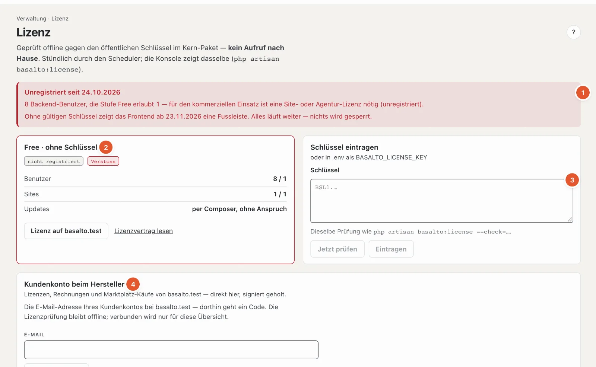

# Lizenz

Unter **Lizenz** sehen Sie, mit welcher Stufe die Installation läuft, ob sie die Grenzen einhält, und tragen den Schlüssel ein. Basalto prüft die Lizenz **offline** — ohne Aufruf nach Hause — und **sperrt nie** eine Funktion.

## Wo

Modus «Verwaltung» › **Lizenz**.

1. **Hinweis oben** — ist die Installation unregistriert, steht hier seit wann und warum, zum Beispiel «3 Backend-Benutzer, die Stufe Free erlaubt 1», und ab wann das Frontend eine Fussleiste zeigt. «Alles läuft weiter — nichts wird gesperrt.»
2. **Die Lizenz-Karte** — Stufe (zum Beispiel «Free · ohne Schlüssel»), Marken **«registriert»/«nicht registriert»** und **«regelkonform»/«Verstoss»**, dann **Benutzer** und **Sites** (genutzt / erlaubt), **Updates** (bis wann neue Versionen inbegriffen sind). Mit Schlüssel dazu Lizenznehmer, Domains, Ausstellung und Schlüssel-ID; bei einer Agentur-Unterlizenz der Kunde. Links «Lizenz auf …» (kaufen oder verlängern) und «Lizenzvertrag lesen».
3. **Schlüssel eintragen** — den Schlüssel einfügen, **«Jetzt prüfen»** zeigt das Ergebnis, ohne etwas einzutragen; **«Eintragen»** übernimmt ihn. Ein ungültiger Schlüssel wird nicht eingetragen. **«Schlüssel entfernen»** führt zurück zu Free. Schlüssel tragen nur Betreiber ein. Steht der Schlüssel in der Datei `.env` der Installation, zeigt die Karte das an — der Eintrag im Backend hat Vorrang.
4. **Kundenkonto beim Hersteller** — siehe unten.

## Stufen

| Stufe | Kurz |
| --- | --- |
| **Free** | ohne Schlüssel: eine Site, ein Backend-Benutzer, alle Module — für Entwicklung, Tests und Privates |
| **Site** | eine Produktions-Domain, bis zu drei Sites in einer Installation; neue Versionen ein Jahr ab Kauf |
| **Agentur** | alle Sites und Installationen für Sie und Ihre Kunden; ein Unterlizenz-Schlüssel je Kunde, auf Wunsch ohne Marke Basalto im Backend |

**Verstoss** heisst: Die Installation überschreitet ihre Stufe — mehr Benutzer oder Sites als erlaubt oder eine Domain, die nicht im Schlüssel steht. Sie gilt dann als unregistriert. Nach **30 Tagen** unregistriert zeigt das Frontend eine schmale Fussleiste; mehr passiert nicht. Ist der Update-Anspruch abgelaufen, läuft die Software weiter; für neue Versionen braucht es eine Verlängerung.

## Kundenkonto beim Hersteller

Wer auf basaltocms.com eine Lizenz gekauft hat, sieht Schlüssel, Rechnungen und Marktplatz-Käufe direkt hier (nur Betreiber):

1. **E-Mail-Adresse** des Kundenkontos eingeben, **«Code anfordern»**. Gibt es dort ein Konto, kommt ein sechsstelliger Code an diese Adresse.
2. **Code** eingeben — je Ziffer ein Feld; Einfügen verteilt den ganzen Code. Sind alle sechs Ziffern da, verbindet Basalto von selbst. Kam nichts an, wird **«Code erneut senden»** nach einer kurzen Wartezeit frei (siehe [Einstellungen](einstellungen.md), «Neuer Code frühestens nach»).
3. Verbunden zeigt die Karte die **Lizenzen** (mit «Diesen Schlüssel verwenden»), die **Rechnungen** als PDF und die **Käufe** im Marktplatz. «Aktualisieren» holt den neuesten Stand, «Trennen» löst die Verbindung.

Die Lizenzprüfung bleibt dabei offline; verbunden wird nur für diese Übersicht. Einzelheiten für die Technik: [Lizenz](../betrieb/lizenz.md).

## Häufige Fragen

**Muss ich sofort eine Lizenz kaufen?**
Nein. Für Entwicklung, Tests und Privates genügt Free. Für den kommerziellen Einsatz mit mehr Personen oder Sites braucht es eine Site- oder Agentur-Lizenz; bis dahin erscheint nach 30 Tagen die Fussleiste.

**Ich sehe «Eintragen» gesperrt.**
Schlüssel tragen nur Betreiber ein — oder das Feld ist noch leer.

## Weiter

- [Lizenz](../betrieb/lizenz.md)
- [Updates](updates.md)
