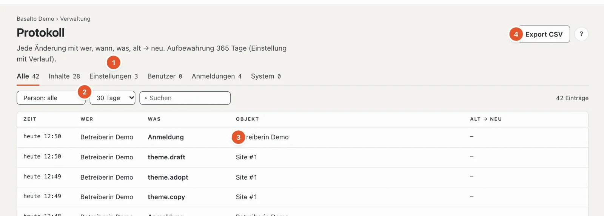

# Protokoll

Das **Protokoll** hält fest, wer wann was geändert hat — mit dem Wert vorher und nachher. So lässt sich jede Änderung nachvollziehen, auch nach Monaten.

## Wo

Modus «Verwaltung» › **Protokoll**. Oben steht, wie lange Einträge aufbewahrt werden (ab Werk 365 Tage, Einstellung «Protokoll aufbewahren»).

1. **Arten** — «Alle», «Inhalte», «Einstellungen», «Benutzer», «Anmeldungen», «System», je mit der Zahl der Einträge.
2. **Person** — nur die Einträge einer Person; **Zeitraum** — 1, 7, 30, 90 oder 365 Tage oder «gesamt»; **Suchen** im Text der Einträge.
3. **Die Einträge** — Zeit, Wer, Was, Objekt (mit «öffnen», wo es das Objekt noch gibt) und **alt → neu**.
4. **«Export CSV»** — die Einträge mit den gesetzten Filtern als Tabelle.

Lange Listen blättern Sie mit «Neuere» und «Ältere». «Filter zurücksetzen» zeigt wieder alles.

## Der Verlauf eines Inhalts

Der Link **«Verlauf»** an einem Inhalt oder einer Einstellung öffnet das Protokoll gefiltert auf dieses Objekt — oben steht dann **«nur: …»**. Mit «Inhaltsfilter entfernen» (×) sehen Sie wieder alle Einträge.

## Was protokolliert wird

- **Inhalte** — anlegen, ändern, einreichen, freigeben, veröffentlichen, löschen, wiederherstellen.
- **Einstellungen** — jede Änderung eines Werts, Themes, Rollen, Module.
- **Benutzer** — Einladungen, Rollen, Deaktivieren, Löschen, Auskunft.
- **Anmeldungen** — erfolgreiche Anmeldungen und Sitzungen.
- **System** — Löschlauf, Veröffentlichungen, Sicherungen, Jobs.

Wird eine Person gelöscht, bleiben ihre Einträge — **anonymisiert**: Statt des Namens steht dort ein Platzhalter. Nichts wird aus dem Protokoll entfernt, ausser durch die Aufbewahrungsfrist.

## Häufige Fragen

**Ein Eintrag fehlt.**
Prüfen Sie den Zeitraum — ab Werk zeigt die Liste die letzten 30 Tage. «gesamt» zeigt alles, was noch aufbewahrt ist.

## Weiter

- [Benutzer](benutzer.md)
- [Einstellungen](einstellungen.md)
