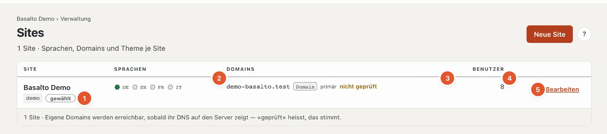

# Sites

Eine Installation kann mehrere Websites betreiben — jede mit eigenen Sprachen, Domains, Theme und Inhalten, verwaltet im selben Backend.

## Wo

Modus «Verwaltung» › **Sites**.

Je Site eine Zeile:

1. **Site** — Name und Handle; «gewählt» markiert die Site, in der Sie gerade arbeiten.
2. **Sprachen** — je Sprache ein Sechseck: grün gefüllt für die Standardsprache, ein grüner Ring für Pflichtsprachen, grau für freiwillige. Die Maus darauf nennt Rolle und Fallback der Sprache.
3. **Domains** — die Adressen der Site mit ihrer Art (Alias, eigene Domain, Weiterleitung), «primär» für die Hauptadresse und «geprüft» bzw. «nicht geprüft». Geprüft heisst: Das DNS der Domain zeigt auf den Server.
4. **Benutzer** — wie viele Personen eine Rolle in der Site haben.
5. **«Bearbeiten»** öffnet die Site; **«Wechseln»** (bei den übrigen Sites) macht sie zur aktuellen Site im ganzen Backend.

**«Neue Site»** legt eine weitere Site an: Name, Handle, Standardsprache und Theme, dann «Speichern und schliessen». Wie viele Sites erlaubt sind, sagt die [Lizenz](lizenz.md). Im Abo legen Besitz und Verwaltung des Kontos neue Sites unter «Konto › Sites» an.

## Eine Site bearbeiten

Was in den vier Reitern «Allgemein», «Sprachen», «Domains» und «Module» steht, erklärt die Hilfe zur Einrichtung: [Die Site](../einrichtung/site.md). Dazu oben rechts:

- **«Anmeldung über SSO»** — die Anmeldung über Microsoft Entra ID oder Google Workspace einrichten (siehe [SSO](../betrieb/sso.md)).
- **«Anmeldung für Kundenkonten»** — Kundinnen und Kunden melden sich im Frontend mit Google, Microsoft, GitHub oder LinkedIn an (siehe [Anmeldung für Kundenkonten](kundenanmeldung.md)).
- **«Export herunterladen»** — die ganze Site als ZIP: Inhalte als JSON und alle Medien, im selben Format wie der Import; ohne Formulareingänge und Mitglieder (Personendaten). Für eine Kopie oder einen Umzug in eine andere Installation. Ein Export ersetzt kein Backup der ganzen Installation (siehe [Betrieb](betrieb.md#backups)).

## Häufige Fragen

**Ich sehe «Neue Site» nicht.**
Ihre Rolle erlaubt den Bereich «Einstellungen, Module und Sites» nicht zum Bearbeiten — oder die Installation läuft im Abo; dann legt das Konto neue Sites an.

**Wie lösche ich eine Site?**
Das geht derzeit weder im Backend noch in der Konsole. Wollen Sie eine Site nicht mehr betreiben, nehmen Sie ihre Domains weg und laden zur Sicherheit den Export herunter.

## Weiter

- [Die Site](../einrichtung/site.md)
- [Benutzer](benutzer.md)
