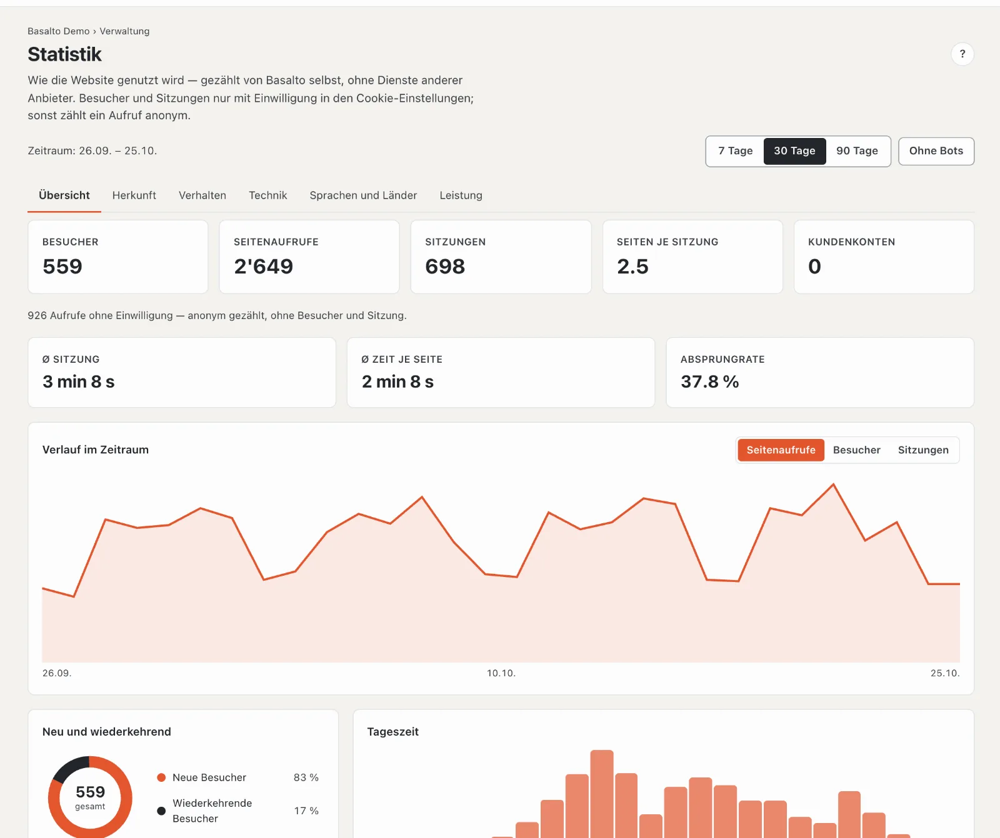
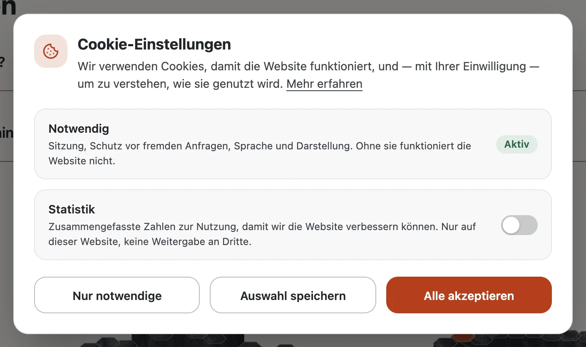

# Statistik

Basalto zählt selbst, wie Ihre Website genutzt wird — ohne Dienste anderer Anbieter, ohne Skript von fremden Servern und ohne IP-Adressen. Unter **Verwaltung › Statistik** sehen Sie Besucher, Seitenaufrufe, Herkunft, meistbesuchte Seiten, Technik, Sprachen und Antwortzeiten der gewählten Site.

## Was gezählt wird

- **Jeder Seitenaufruf** der Website zählt — auch Seiten, die schnell aus dem Seiten-Cache kommen. Nicht gezählt werden das Vorabladen des Browsers, Fehlerseiten und Personen, die im Backend angemeldet sind (Sie selbst und Ihr Team).
- **Ohne Einwilligung** zählt ein Aufruf **anonym**: Seite, Verweis (nur der Host), Browser, System, Gerät und Sprache — ohne Cookie und ohne Kennung. So stimmen die Seitenaufrufe, aber Besucher und Sitzungen fehlen.
- **Mit Einwilligung** in den Cookie-Einstellungen legt der Browser zwei zufällige Kennungen an: eine für den Besucher (ein Jahr) und eine für die Sitzung (30 Minuten ohne Aktivität). Damit zählt Basalto Besucher, Sitzungen, Verweildauer, Absprünge sowie Einstiegs- und Ausstiegsseiten. Ein Browser mit «Global Privacy Control» zählt immer anonym.
- **Keine IP-Adresse** und **keine Abfrage** der Adresse werden gespeichert — aus `?utm_source=…` übernimmt Basalto nur Quelle, Medium und Kampagne.
- **Das Land** erscheint nur, wenn ein vorgeschalteter Dienst wie Cloudflare es mitgibt.

## Die Auswertung lesen

Oben wählen Sie den **Zeitraum** (7, 30 oder 90 Tage) und ob **Bots** mitzählen. Ein Klick auf eine Seite, einen Verweis, einen Browser, ein Gerät, ein Land oder eine Sprache **grenzt die ganze Auswertung ein**; die Auswahl steht oben und lässt sich einzeln entfernen.

| Reiter | Inhalt |
| --- | --- |
| **Übersicht** | Besucher, Seitenaufrufe, Sitzungen, Seiten je Sitzung, Kundenkonten; Ø Sitzung, Ø Zeit je Seite, Absprungrate; Verlauf im Zeitraum, neue und wiederkehrende Besucher, Tageszeit |
| **Herkunft** | Kanäle (direkt, Suchmaschinen, soziale Netzwerke, Kampagnen, Verweise), Verweise und Kampagnen (UTM) |
| **Verhalten** | meistbesuchte Seiten, Einstiegs- und Ausstiegsseiten, letzte Aufrufe |
| **Technik** | Geräte, Browser und Betriebssysteme |
| **Sprachen und Länder** | Sprache der aufgerufenen Seiten und Länder |
| **Leistung** | Antwortzeit des Servers (Ø, p50, p90, p99), langsamste Seiten und Bots |

Tage und Stunden richten sich nach der Zeitzone der Site.

## Cookie-Einstellungen

Zählt eine Site Besuche, fragen die **Cookie-Einstellungen** beim ersten Besuch nach der Einwilligung:

- **Notwendig** ist immer aktiv (Sitzung, Schutz vor fremden Anfragen, Sprache, Darstellung).
- **Statistik** ist ab Werk aus — eine vorab angekreuzte Einwilligung gälte nicht. Bindet das Theme Dienste anderer Anbieter ein, kommt **Externe Inhalte** dazu.
- **Nur notwendige**, **Auswahl speichern** und **Alle akzeptieren** sind gleich gross und gleich leicht zu erreichen.
- Die Wahl gilt ein Jahr. Über **Cookie-Einstellungen** in der Fusszeile ändern Besucher sie jederzeit; «Mehr erfahren» führt zur Datenschutzerklärung der Site in der Sprache der Seite — zur Seite, die das Theme unter `publish { legal { datenschutz: … } }` nennt (sonst zur Seite unter `/datenschutz`), mit der Adresse, die sie in dieser Sprache hat. Ist sie nicht veröffentlicht, fehlt der Link.

## Einschalten, ausschalten, aufbewahren

- **Verwaltung › Einstellungen › Statistik › Besuche zählen** — je Site, ab Werk an. Ausgeschaltet kommen keine Aufrufe dazu, und die Cookie-Einstellungen erscheinen nur noch, wenn das Theme Dienste anderer Anbieter einbindet.
- **Verwaltung › Einstellungen › Aufbewahrung › Statistik aufbewahren** — ab Werk 400 Tage; ältere Aufrufe löscht der nächtliche Löschlauf.
- **Wer die Statistik sieht**, legt die Rolle fest (Bereich «Statistik»); ab Werk Betreiber und Administrator.
- **Auskunft und Löschung** einer Person lösen ihre Aufrufe vom Kundenkonto; die Zahlen bleiben anonym erhalten. Der Export einer Site nimmt die Statistik nicht mit.
- **Datenschutzerklärung:** Nennen Sie die eigene Statistik und die Cookie-Einstellungen in der Datenschutzerklärung der Site.

## Für Themes

Ein Link auf `#cookie-einstellungen` öffnet die Cookie-Einstellungen von überall. Die mitgelieferten Themes setzen ihn in die Fusszeile, versteckt, bis die Einstellungen auf der Seite stehen (`data-cookie-link hidden`). Skripte anderer Anbieter stehen als `<script type="text/plain" data-consent …>` im Theme und `publish { cookie: consent }` erklärt sie — sie laufen erst nach Zustimmung zu «Externe Inhalte».

## Weiter

- [Einstellungen](einstellungen.md)
- [Rollen](rollen.md)
- [Anmeldung für Kundenkonten](kundenanmeldung.md)
- [Lava](../entwickler/lava.md)
