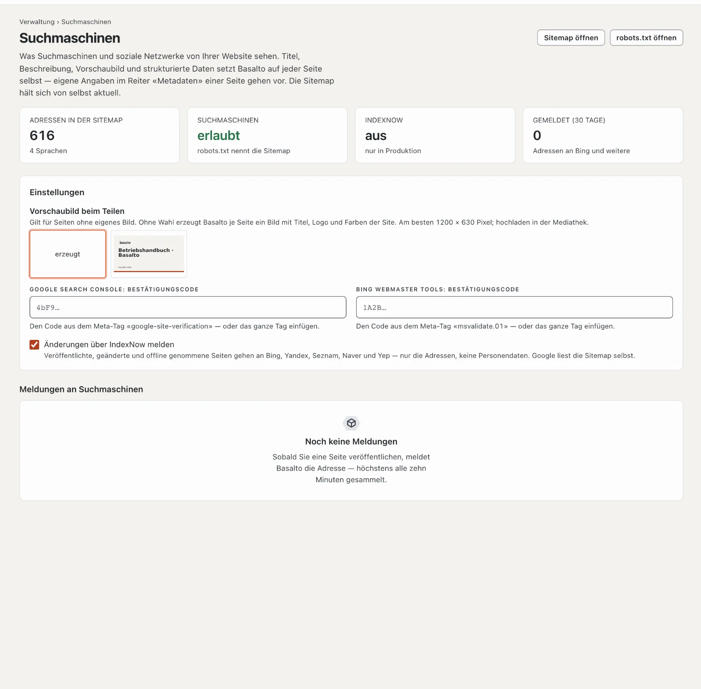

# Suchmaschinen

Basalto bereitet jede öffentliche Seite selbst so auf, dass Suchmaschinen und soziale Netzwerke sie verstehen: Titel,
Beschreibung, Vorschaubild, Sprachfassungen, strukturierte Daten und die Sitemap. Unter **Verwaltung › Suchmaschinen**
sehen Sie, was davon ankommt, und legen die wenigen Angaben fest, die Basalto nicht selbst wissen kann.

## Was Basalto auf jeder Seite selbst setzt

Sie müssen dafür nichts tun — weder in der Redaktion noch im Theme. Was Sie in den Einstellungen einer Seite im Reiter
**Metadaten** selbst angeben, geht immer vor.

| Angabe | Woher sie kommt |
| --- | --- |
| **Titel** | Titel der Seite mit dem Zusatz des Themes (etwa «· Name der Site») — ohne Zusatz, wenn der Name schon im Titel steht |
| **Beschreibung** | eigene Beschreibung, sonst die Einleitung, sonst der erste Absatz im Inhalt — gekürzt auf rund 160 Zeichen am Wortende |
| **Vorschaubild** | Seitenbild, sonst das erste Bild im Inhalt, sonst das Vorschaubild der Site, sonst ein Bild, das Basalto selbst erzeugt |
| **Kanonische Adresse** | die Adresse der Seite in dieser Sprache; Ansichten mit eigenem Inhalt (ein Eintrag im Marktplatz) behalten ihren Parameter |
| **Sprachfassungen** | jede Sprache mit eigener Fassung, dazu die Standardsprache als Vorgabe (`hreflang`) |
| **Strukturierte Daten** | Website und Organisation mit Logo auf der Startseite, Seite und Brotkrumen überall, Artikel mit Datum und Autorin bei Beiträgen; Module ergänzen ihre eigenen (Veranstaltung, Stelle, Forumsbeitrag, Software im Marktplatz) |
| **Sitemap** | `/sitemap.xml` mit einer Sitemap je Sprache, jede Adresse mit letzter Änderung, Sprachfassungen und Seitenbild — von selbst aktuell |
| **robots.txt** | erlaubt Suchmaschinen alles ausser dem Backend und nennt die Sitemap |

Seiten nur für Mitglieder, Entwürfe, Weiterleitungen und Seiten mit «noindex» stehen weder in der Sitemap noch im
Index. Wer Ihre Website mit oder ohne «www.» aufruft, landet auf der Hauptdomain der Site (Weiterleitung 301) — für
Suchmaschinen gibt es sie nur einmal.

## Das Vorschaubild für geteilte Links

Teilt jemand einen Link auf Ihre Website — in einer Nachricht, auf LinkedIn oder Facebook —, zeigt die Vorschau ein Bild.
Hat eine Seite kein eigenes Bild, nimmt Basalto das **Vorschaubild beim Teilen** der Site. Ist auch keines gewählt,
erzeugt Basalto je Seite eines: 1200 × 630 Pixel mit dem Titel der Seite, dem Logo und der Adresse in den Farben Ihres
Themes.

1. Laden Sie ein Bild in die **Mediathek** — am besten 1200 × 630 Pixel, als JPEG, PNG oder WebP.
2. Öffnen Sie **Verwaltung › Suchmaschinen** und wählen Sie es unter **Vorschaubild beim Teilen**. Es speichert sich
   selbst.

## Bei Google anmelden

Google findet die Sitemap über `robots.txt` von selbst. In der **Google Search Console** sehen Sie zusätzlich, welche
Seiten im Index sind, mit welchen Suchbegriffen Besucher kommen und ob Google Fehler meldet.

1. Öffnen Sie die Google Search Console und fügen Sie eine **Property** mit der Art **URL-Präfix** hinzu — die Adresse
   Ihrer Website, etwa `https://www.beispiel.ch/`.
2. Wählen Sie als Bestätigung **HTML-Tag** und kopieren Sie das Tag.
3. Fügen Sie es in Basalto unter **Verwaltung › Suchmaschinen › Google Search Console: Bestätigungscode** ein — das
   ganze Tag oder nur den Code aus `content="…"`.
4. Klicken Sie in der Search Console auf **Bestätigen**.
5. Reichen Sie unter **Sitemaps** die Adresse `sitemap.xml` ein.

Steht oben links in der Search Console nur der Name der Domain (`beispiel.ch`, ohne `https://`), ist Ihre Website als
**Domain** bestätigt — meist über einen Eintrag im DNS. Dann entfallen die Schritte 2 bis 4, das Feld in Basalto bleibt
leer. Unter **Sitemaps** tragen Sie bei einer Domain die ganze Adresse ein: `https://beispiel.ch/sitemap.xml`.

Für **Bing Webmaster Tools** gilt dasselbe mit dem Tag `msvalidate.01`; Bing kann eine bestätigte Website auch aus der
Search Console übernehmen.

## Änderungen melden mit IndexNow

Veröffentlichen Sie eine Seite, ändern Sie sie oder nehmen Sie sie offline, meldet Basalto ihre Adresse über
**IndexNow** an Bing, Yandex, Seznam, Naver und Yep — gesammelt höchstens alle zehn Minuten. Gemeldet werden nur
Adressen, keine Personendaten. Den Schlüssel, den IndexNow verlangt, erzeugt Basalto selbst und liefert ihn unter der
Adresse der Site aus. Die Liste **Meldungen an Suchmaschinen** zeigt, was gemeldet ist.

IndexNow meldet nur, wenn die Site **live** ist, Suchmaschinen erlaubt sind und Basalto **in Produktion** läuft — eine
Testumgebung meldet nie. Abschalten lässt es sich unter **Änderungen über IndexNow melden**. Google nimmt IndexNow
nicht; Google liest die Sitemap.

## Wie Suchmaschinen Ihre Website nutzen

Wie viele Besuche aus Suchmaschinen kommen, über welche Seiten sie einsteigen und wie oft Googlebot und andere Crawler
vorbeischauen, zeigt der Reiter **Suchmaschinen** unter [Statistik](statistik.md).

## Wenn etwas nicht klappt

| Zeichen | Ursache | Lösung |
| --- | --- | --- |
| **Suchmaschinen: nicht erlaubt** | Das Theme sperrt Suchmaschinen (`publish { robots: disallow }`) oder es ist eine Testumgebung | Theme anpassen; Testumgebungen bleiben bewusst gesperrt |
| **IndexNow: aus — nur in Produktion** | Basalto läuft lokal oder in einer Testumgebung | so gewollt; in Produktion meldet es von selbst |
| Die Search Console findet das Tag nicht | Code noch nicht gespeichert oder die Seite kommt noch aus einem Zwischenspeicher | Code prüfen, eine Minute warten, erneut bestätigen |
| Die Vorschau zeigt ein altes Bild | Netzwerke behalten Vorschauen eine Weile | im Werkzeug des Netzwerks neu abrufen lassen (z. B. Facebook «Sharing Debugger») |

## Weiter

- [Statistik](statistik.md)
- [Seiten und Seitenbaum](../redaktion/seiten.md)
- [Live gehen](../einrichtung/live-gehen.md)
- [Einstellungen](einstellungen.md)
