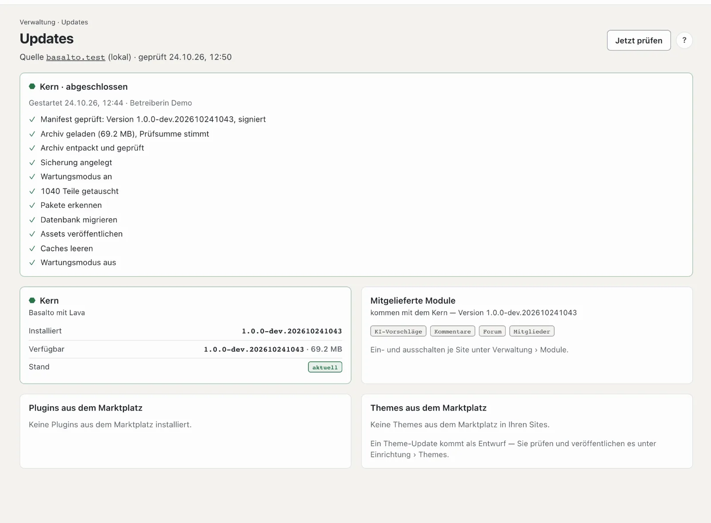

# Updates

**Updates** zeigt, ob Basalto aktuell ist: der Kern, die mitgelieferten Module, Plugins und Themes aus dem
Marktplatz. Ist etwas Neues da, spielen Sie es von hier aus ein — mit Sicherung und Rückweg.

## Wo

Modus «Verwaltung» › **Updates**. Die Zahl neben dem Eintrag nennt die verfügbaren Updates aus der letzten Prüfung.

Oben steht die **Quelle**, also der Hersteller, bei dem Basalto nachfragt:
- `basaltocms.com` für Produktion und Demo,
- `testing.basaltocms.com` in Test-Umgebungen,
- `basalto.test` in der lokalen Entwicklung.

Basalto prüft einmal am Tag von selbst. Mit **«Jetzt prüfen»** holen Sie den Stand sofort. Gibt es Neues, kommt eine
Benachrichtigung in die Glocke und, wenn eingestellt, per Mail — für jeden neuen Stand einmal.

Mit der Prüfung schickt Basalto **Nutzungsangaben** an den Hersteller: eine zufällige Kennung dieser Installation, die
Version, die PHP-Version und die Art der Datenbank. Adressen, Inhalte und Personendaten gehen nicht mit; der Hersteller
speichert nur eine Prüfsumme der Kennung und zählt damit aktive Installationen und Versionen. Ausschalten unter
**Einstellungen** › Betrieb › «Nutzungsangaben an den Hersteller» — die Prüfung auf Updates läuft dann ohne diese Angaben.

## Die Karten

| Karte | Was sie zeigt | Was tun |
| --- | --- | --- |
| **Kern** | installierte und verfügbare Version, Grösse, «Was ist neu?» | «Auf … aktualisieren» |
| **Mitgelieferte Module** | Forum, Kommentare, Mitglieder, KI … — sie kommen mit dem Kern | je Site ein- und ausschalten unter **Module** |
| **Plugins aus dem Marktplatz** | installierte und neue Version je Plugin | «Aktualisieren» |
| **Themes aus dem Marktplatz** | je Site das Theme mit installierter und neuer Version | «Als Entwurf laden» |

## Den Kern aktualisieren

Nach «Auf … aktualisieren» bestätigen Sie. Basalto arbeitet dann der Reihe nach; die Seite zeigt jeden Schritt:

1. Archiv laden und Signatur prüfen — nur Releases, die der Hersteller signiert hat
2. Sicherung von Datenbank und Medien
3. Wartungsmodus — die Website zeigt kurz eine Wartungsseite, Sie selbst arbeiten weiter
4. Dateien tauschen, Datenbank migrieren, Assets und Caches erneuern
5. Wartungsmodus aus

**Geht ein Schritt schief, kommen die alten Dateien zurück.** Die Datenbank bleibt dabei, wie sie ist — die
Migrationen von Basalto sind so gebaut, dass auch der alte Stand damit läuft.

Unberührt bleiben `.env`, der Speicher (Medien, Sicherungen, Protokolle), die Datenbankdatei und eigene Themes.

## Themes

Ein Theme-Update kommt **als Entwurf**: Sie sehen sich die Änderungen unter Einrichtung › Themes in der Vorschau an und
veröffentlichen erst dann. Ein bezahltes Theme braucht E-Mail und Token Ihres Kundenkontos beim Hersteller.

## Plugins

Plugins aus dem Marktplatz spielt Basalto genauso ein wie den Kern: signiertes Archiv, Sicherung, Tausch, Migrationen,
Rückweg. Dafür braucht es E-Mail und Token Ihres Kundenkontos beim Hersteller (wie für Composer).

## Wenn «Einspielen» fehlt

- **Git-Arbeitsstand oder Composer:** Wurde Basalto mit Git oder Composer eingerichtet, prüft die Seite nur. Den Befehl
  zum Aktualisieren auf dem Server zeigt sie dazu an.
- **Abo (SaaS):** Im Abo spielt der Betreiber Kern und Plugins ein. Sie sehen hier nur die Themes Ihrer Site.
- **Keine Schreibrechte:** Die Seite nennt den Ordner — die Technik richtet die Rechte ein.

## Update-Anspruch

Ist der Update-Anspruch Ihrer Lizenz abgelaufen, steht ein Hinweis auf der Seite. Basalto läuft weiter, und nichts
wird gesperrt; neue Versionen gehören zur Verlängerung (siehe [Lizenz](lizenz.md)).

Die technische Seite — Befehl `basalto:update`, Quelle je Umgebung, Zurückholen von Hand — steht in der
[Betriebs-Doku](../betrieb/updates.md).

## Weiter

- [Updates](../betrieb/updates.md)
- [Backup](../betrieb/backup.md)
