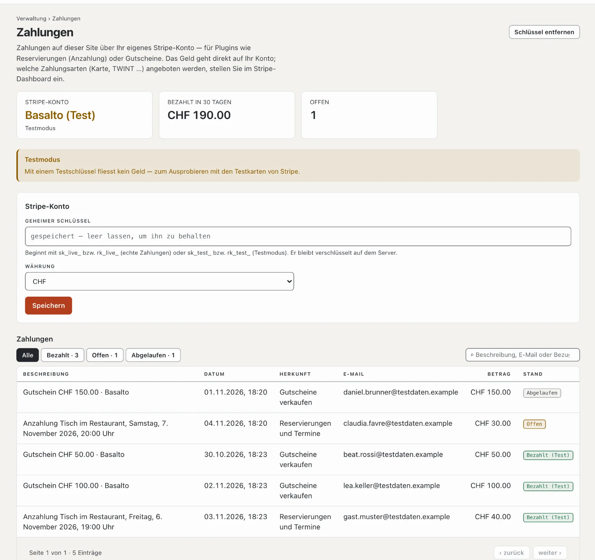

# Zahlungen

Plugins wie «Reservierungen und Termine» (Anzahlung) und «Gutscheine verkaufen» nehmen Zahlungen entgegen — über Ihr
eigenes Konto bei Stripe. Unter **Verwaltung › Zahlungen** verbinden Sie es und sehen alle Zahlungen der Site. Das Geld
geht direkt auf Ihr Konto; Basalto ist daran nicht beteiligt.

## Das Stripe-Konto verbinden

1. Bei Stripe ein Konto eröffnen (oder Ihr bestehendes nehmen) und im Stripe-Dashboard unter **Entwickler ›
   API-Schlüssel** den **geheimen Schlüssel** kopieren — er beginnt mit `sk_live_`. Ein eingeschränkter Schlüssel
   (`rk_live_`) mit Schreibrecht auf «Checkout Sessions» genügt.
2. Unter **Verwaltung › Zahlungen** einfügen, **Währung** wählen (CHF oder EUR), **«Speichern»**.
3. Basalto fragt Stripe sofort, ob der Schlüssel gilt, und zeigt den Namen des Kontos.

Der Schlüssel bleibt verschlüsselt auf dem Server und geht nie zurück an den Browser; leer gelassen bleibt der
gespeicherte. **«Schlüssel entfernen»** trennt das Konto — neue Zahlungen gehen dann nicht mehr, bestehende bleiben in
der Liste.

## Ausprobieren im Testmodus

Mit einem Testschlüssel (`sk_test_…`) fliesst kein Geld; Sie bezahlen mit den Testkarten von Stripe. Die Seite zeigt
**«Testmodus»**, bezahlte Zahlungen erscheinen als **«Bezahlt (Test)»**. Für den echten Betrieb tauschen Sie den
Schlüssel gegen den `sk_live_…`.

## Wie eine Zahlung abläuft

1. Ein Gast reserviert oder kauft; Basalto legt die Zahlung an und leitet zu Stripe weiter.
2. Dort bezahlt er mit den Zahlungsarten, die Sie im Stripe-Dashboard eingeschaltet haben — Karte, TWINT und andere.
3. Zurück auf Ihrer Site fragt Basalto Stripe nach dem Stand. Schliesst der Gast das Fenster vorher, holt Basalto den
   Stand alle fünf Minuten selbst nach — dafür braucht es den Zeitplan der Installation ([Betrieb](betrieb.md)).
4. Läuft ein Checkout ab, ohne dass bezahlt wurde, gibt das Plugin den Platz bzw. die Bestellung frei.

Rückerstattungen und Auszahlungen erledigen Sie im Stripe-Dashboard.

## Die Liste der Zahlungen

Oben stehen das Konto (echte Zahlungen oder Testmodus), was in den letzten 30 Tagen bezahlt wurde und wie viele
Zahlungen offen sind. Die Liste zeigt Datum, Beschreibung, Herkunft (das Plugin), E-Mail, Betrag und Stand —
**Bezahlt**, **Offen** oder **Abgelaufen** —, mit Suche und Filter.

## Wer Zahlungen sieht

Der Bereich heisst **«Zahlungen»** ([Rollen](rollen.md)); ab Werk haben ihn Betreiber und Administrator.

## Weiter

- [Plugin «Reservierungen und Termine»](../marktplatz/plugin-reservierungen.md)
- [Plugin «Gutscheine verkaufen»](../marktplatz/plugin-gutscheine.md)
- [Rollen](rollen.md)
